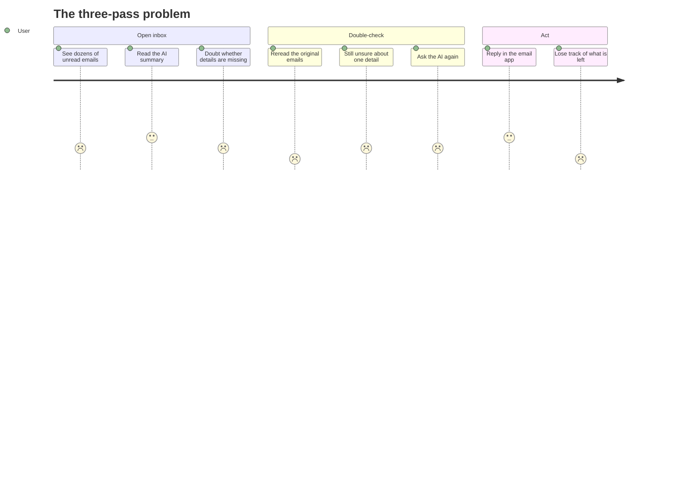
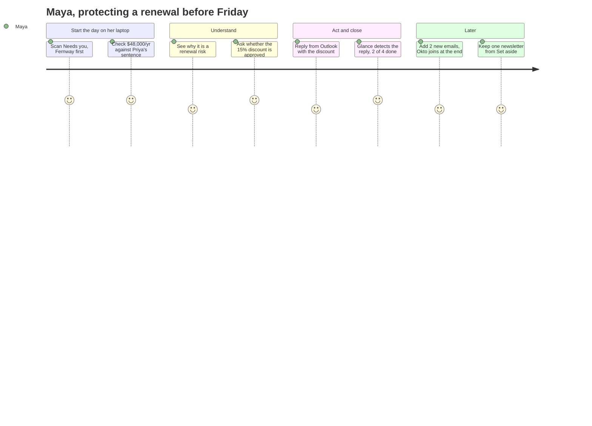
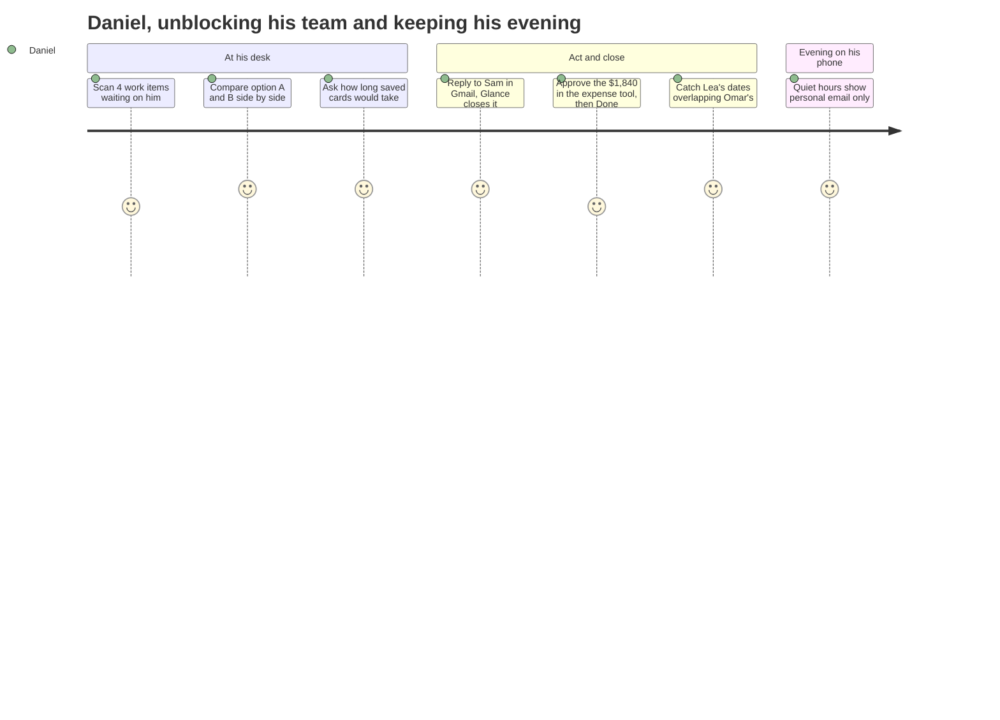
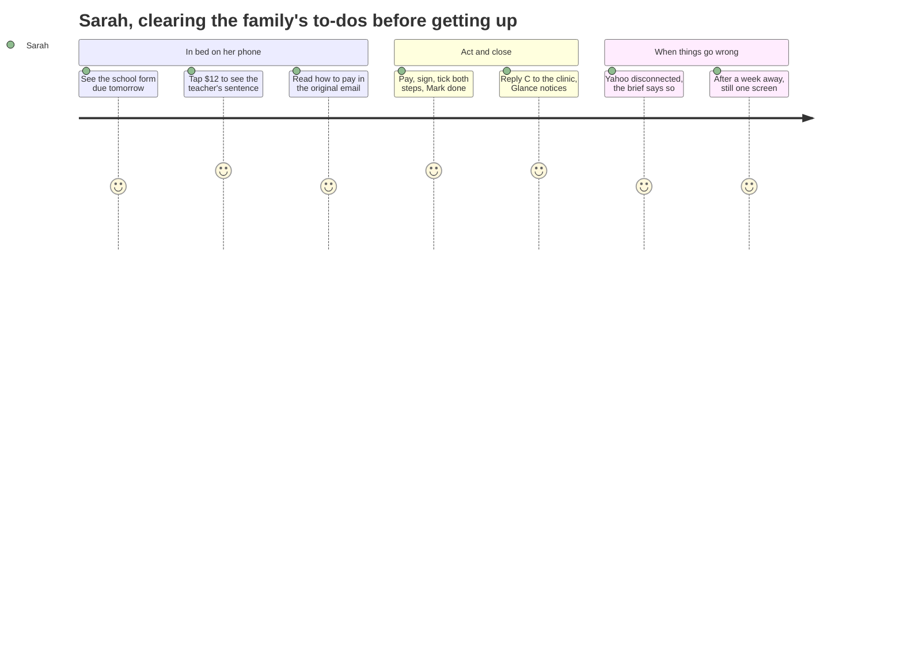
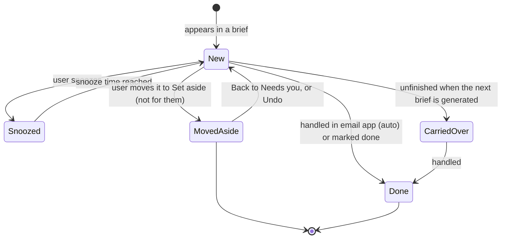
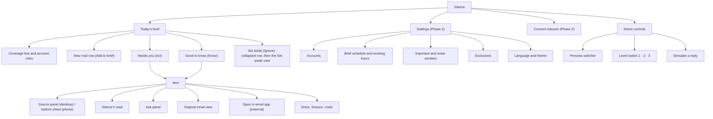
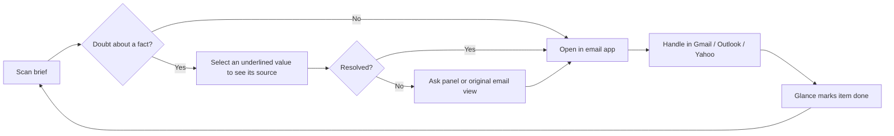

# Glance — Product Brief

**Status:** v0.4 (design handoff)
**Owner:** Shuhao Shang (Design)
**Last updated:** November 3, 2026
**Related:** [User flows](user-flows.md) · [Design rules](design-rules.md) · [Design system](design-system.md) · [Decision log](decisions.md) · [Data model](data-model.md) · [Handoff](handoff/README.md)

> Diagrams in this document are written in Mermaid and render automatically on GitHub.

### What changed in v0.4

- **User flows:** each persona's story is walked end to end on the real screens in [User flows](user-flows.md), with acceptance criteria for every step. §5 and §6 now match the final design.
- **New states found by the walk:** a checklist with every step ticked makes **Mark done** the primary (§9), the phone brief after items are done, and an evening view for quiet hours (§10, §14).
- **Final review:** “Move to Set aside” lets the user correct a false alarm (§9, §11); every Good to know fact opens its source (§8); the demo’s Ask tab offers prepared questions only; list requests get two lines on desktop. Decisions D37–D40.

### What changed in v0.3

Ten rounds of design are now reflected here; the reasoning for each change is in the [decision log](decisions.md).

- **Tier names:** Act / Know / Ignore are shown to users as **Needs you / Good to know / Set aside** (code keeps the short names).
- **Sources open on click or tap,** not hover; on desktop they open inside the item, on phone in a bottom sheet. Source words are highlighted like a highlighter, by type.
- **Lists are uniform, details are specific:** one row for every item; the detail view uses one of 8 scene cards, or a text fallback (§16).
- **Account labels mark only the less common inbox.**
- **Edge states are designed** (§14), and the open question on L1/L2/L3 is answered: it is a demo control (§18).
- **Visual language is defined:** white and gray surfaces, Inter, purple for Glance, pastel ink for facts, light and dark tokens.

---

## Contents

1. The problem
2. The thesis
3. What Glance is
4. Personas
5. Jobs to be done
6. User journeys
7. Design principles
8. Anatomy of a brief
9. Item lifecycle and closing the loop
10. Brief cadence and updates
11. Prioritization and personalization
12. Trust and accuracy
13. Accounts and privacy
14. Edge and system states
15. Information architecture
16. Design system architecture
17. Screens
18. Demo-only features
19. Accessibility and internationalization
20. How success would be measured
21. Scope
22. Open questions

---

## 1. The problem

AI email summaries were supposed to save time. In practice, they often add a step.

- **Compressed too much**, a summary loses the details that matter.
- **Compressed too little**, it is no faster than reading the original.
- Either way, there is **no quick way to verify** what the AI said. People don't trust AI with important things, so they read the original email anyway, and then ask the AI again about what's still unclear.

The result: one pass (read the email, maybe ask the AI) becomes three passes (read the summary, read the original, ask the AI again).

## 2. The thesis

> **Components make it fast. Sources make it trustworthy.**

- **Fast**: key information is shown through design-system components (amounts, deadlines, people, actions) instead of paragraphs.
- **Trustworthy**: every piece of information can be traced back to the exact sentence in the original email, in one gesture, without rereading the whole email.

## 3. What Glance is

Glance is an **AI briefing layer** on top of the user's existing inboxes. It is **not** a full email client.

- **Glance reads and briefs.** It tells the user what needs action, what they should know and what they can ignore, across all their connected inboxes.
- **The email app writes.** Replying, composing and searching stay in Gmail, Outlook or Yahoo Mail, which already have their own AI writing tools.
- **Glance keeps score.** When the user handles something in their email app, Glance detects it and marks the item as done. The loop closes through progress, not by doing everything in one place.

**Form:** a standalone, responsive web app for desktop and mobile browsers.

### Connecting inboxes

- Each inbox is connected once through the provider's official authorization (OAuth): Gmail, Outlook, Yahoo Mail; other providers through IMAP.
- Glance never sees the user's password. Access is **read-only** by default and can be revoked at any time from the provider's account settings.
- Multiple inboxes are combined into one brief. The coverage line shows the split (“Work 64 · Personal 8”), and only items from the less common inbox carry an account label: mark the exception, not the rule.
- *Production note:* reading Gmail requires passing Google's security review for restricted scopes. This is out of scope for the demo but a real cost for a shipped product.

## 4. Personas

### Maya — Sales / Customer Success

- Account manager at a B2B SaaS company, responsible for 30 customer accounts
- **Accounts:** work (Outlook)
- **When and where:** reads the brief on her laptop in the morning; checks her phone between meetings
- **Typical emails:** inquiries from potential customers, customer replies, renewal notices, meeting bookings, internal discount approvals, industry newsletters
- **Core question:** *Which customer must I follow up with today, and how much money is involved?*

### Daniel — Manager / Team Lead

- Design manager leading a team of 8
- **Accounts:** work (Google Workspace) and personal (Gmail)
- **When and where:** reads the brief on his desktop after arriving at the office; does not want to see work email after hours
- **Typical emails:** time-off and expense approvals, weekly project reports, escalations, interview feedback on candidates, lots of CC'd notifications
- **Core question:** *What needs my approval or decision, and which project is at risk?*

### Sarah — Family Manager

- Parent of two children
- **Accounts:** personal (Gmail) and an older family account (Yahoo Mail) that the school still uses
- **When and where:** reads the brief on her phone right after waking up; handles things in batches on her laptop on weekends
- **Typical emails:** school notices (permission slips, events, fees), after-school activity schedules, medical appointments, utility bills, deliveries, promotions
- **Core question:** *What does our family need me to handle this week?*

## 5. Jobs to be done

### Core job (all users)

> **When** my inboxes fill up, **I want to** know what needs me and trust that nothing important was missed, **so I can** act quickly and stop rereading.

### Persona jobs

| Persona | Main job | Emotional job | Social job |
|---|---|---|---|
| **Maya** | When I start my day, I want to see which customers need a follow-up and what is at stake, so I can protect revenue and respond before it is too late. | Feel in control of 30 accounts at once | Be seen by customers as responsive and reliable |
| **Daniel** | When I sit down at my desk, I want to clear approvals and spot project risks, so my team is never blocked by me. When I leave work, I want work to stay at work. | Confidence that no escalation slipped past | Be the manager who unblocks, not the bottleneck |
| **Sarah** | When I wake up, I want to know what the family needs this week, so forms, fees and appointments never slip. | Relief instead of background anxiety | Be the parent other people can count on |

### Supporting jobs (shared)

| Job | Glance feature |
|---|---|
| Check that a fact is right without rereading the email | Select a value: the source sentence opens with the words highlighted |
| Understand why something is ranked as important | Glance’s read: the ranking reason and judgments, each with evidence |
| Know what is left to do | Progress (“2 of 4 done”) and done rows with Undo |
| Ignore noise without fear of missing something | Set aside, collapsed with counts; “Show in brief” brings an email back |
| Get a specific question answered | Ask: answers only from email, with sources, or “Not in your email” |
| Keep work out of the evening | Per-account quiet hours that say what is waiting |

## 6. User journeys

The full flows, with a screen for every step and Given / When / Then acceptance criteria, are in **[User flows](user-flows.md)**. This section is the summary.

### Today, without Glance

### With Glance — stages

| Stage | User is doing | User is thinking | Glance's role |
|---|---|---|---|
| **1. Open and scan** | Starts the day / sits at desk / wakes up | “What can’t wait?” | The brief is ready: one screen, ranked by urgency then value, done items already shown as done |
| **2. Verify** | Selects a value they doubt | “Is that amount really right?” | Opens the exact sentence, the words highlighted by type |
| **3. Understand** | Opens Glance’s read | “Why is this here?” | The ranking reason and judgments, each with its evidence |
| **4. Ask** | Asks a follow-up | “Is the discount approved?” | Answers only from email, with the source, or says “Not in your email” |
| **5. Act** | Reads the original, then handles it in the email app or another tool | “Let me just reply.” | Highlights every fact it used; one primary action hands off |
| **6. Close** | Comes back to Glance | “What’s left?” | Reply detected or marked done; progress moves; Undo is always there |
| **7. Return** | Checks again later | “Did anything new come in?” | “2 new · Add to brief” waits; nothing reshuffles |
| **Tidy** | Opens Set aside | “Did Glance hide anything I want?” | “Show in brief” moves an email to Good to know and teaches Glance |
| **After hours** | Looks at the phone in the evening | “Do I have to deal with anything tonight?” | Shows only what the account rules allow, and says what is waiting |

### Maya

### Daniel

### Sarah

## 7. Design principles

1. **Small enough to be worth it.** The brief fits on one screen and can be read in about 30 seconds. Even if it turns out to be unnecessary, reading it should feel like no real cost.
2. **Quiet by default, sources on demand.** Sources are not displayed up front, because visible citations make the screen busy. Verifiable values carry a subtle hint (a dotted underline in their type color); the source appears on click or tap (inside the item on desktop, in a bottom sheet on mobile), with the original words highlighted. Hover was tried and dropped: the popover covered the next items. The faster a doubt is resolved, the more the user comes back.
3. **Extract, don't paraphrase.** Amounts, dates, names and explicit requests are taken from the email as written. Rewording is where trust is lost.
4. **Complete, not just correct.** Users must be able to see that nothing was missed: how many emails the brief covers, from which accounts, and what was filed under Ignore. Nothing disappears silently.
5. **Explain on request.** Any item can answer "why is this here?" (e.g. "due today, from your manager"), but only when asked.
6. **Stable while reading.** New emails never reshuffle a brief the user is reading. They arrive as a clearly marked update.
7. **Components only where the content has structure.** Emails with a stable structure are shown as components. Content without a stable structure falls back to clear typographic hierarchy. Knowing when **not** to use a component is part of the system.
8. **Motion explains change.** Animation is used to show state changes (an item completing and collapsing, new items arriving), never for decoration.

### Levels of AI output

| Level | Output form | Reader effort |
|---|---|---|
| L1 | Plain paragraphs | Highest |
| L2 | Typographic hierarchy: headings, lists, tables | Medium |
| L3 | Components chosen by rules | Lowest |

## 8. Anatomy of a brief

### Coverage header

Always visible at the top: what the brief covers and how far the user has got.

> *Covers 47 emails from 2 accounts since yesterday 8:00 · 3 of 5 actions done*

### Three tiers

1. **Needs you** (Act) — things that need the user to do something (reply, approve, sign, pay)
2. **Good to know** (Know) — things worth being aware of (status, schedules, progress). Each row has one underlined value that opens its source, like every other fact.
3. **Set aside** (Ignore) — noise, collapsed by default with a count (promotions, CC'd notifications, newsletters). “Show in brief” moves one back and teaches Glance.

This layout is a design-system pattern shared by all personas.

### Anatomy of an item

| Part | Visibility |
|---|---|
| List row: name, one-line request (quote or ✦ summary), up to 2 fact chips | Always, identical for every item |
| Scene card (the facts, laid out by the email’s structure) | In the detail view |
| Account label | Only for the less common inbox |
| Primary action (e.g. Open in Gmail) | In the detail view |
| Source excerpt | On click / tap of an underlined value |
| Reason ("why is this here?") | On request |
| Ask a follow-up | On request |

## 9. Item lifecycle and closing the loop

| State | How it happens |
|---|---|
| **New** | Item appears in a brief |
| **Done (auto)** | Glance detects the user replied, paid or accepted in their email app |
| **Done (manual)** | User marks it done in Glance |
| **Snoozed** | User hides it until a chosen time; it returns to Act |
| **Moved to Set aside** | User says it doesn’t need them (“Move to Set aside”, at the end of Glance’s read). It leaves Needs you, is not counted as an action or as done, shows under “Moved by you” in Set aside, and teaches Glance. Undo or “Back to Needs you” restores it ([D37](decisions.md)) |
| **Carried over** | An unfinished Act item from a previous brief appears in today's brief, marked as carried over |

Unfinished actions never fall out of the brief silently. When Needs you is empty, the heading is “Nothing else needs you right now” if snoozed items will return later, or “Nothing else needs you today” when nothing is snoozed. The body states the snoozed count when present and the Good to know and Set aside counts.

**Checklist items** (more than one step, such as “sign and pay”): ticks are local progress. When every step is ticked, **Mark done** becomes the one primary action, but the item stays in Needs you until the user marks it done or a reply is detected. The user may want to keep it until the other side confirms ([D34](decisions.md)).

## 10. Brief cadence and updates

- A brief is generated on a schedule (e.g. every morning) and can be refreshed on demand.
- Emails that arrive after the brief was generated appear as an update ("4 new since 8:00"), not as a reshuffled brief.
- Per-account time rules: e.g. a work account's items are hidden after working hours (Daniel). In the evening the phone shows personal email only, says how many work emails are waiting for tomorrow's brief, and offers “Show work email anyway” ([D35](decisions.md)).

## 11. Prioritization and personalization

**Signals the AI uses to rank Act items:** deadline urgency, explicit requests to the user, sender importance, amount of money involved, and whether the user is waiting on it or someone is waiting on the user.

**User controls:**
- Mark senders as important (always surface) or noise (always Ignore)
- “Move to Set aside” on a Needs you item, and “Show in brief” on a Set aside email: the two directions of the same correction
- Exclude senders or labels from AI processing entirely (e.g. medical or banking emails)

## 12. Trust and accuracy

- **Sources:** every extracted fact links to its original sentence (principle 2)
- **Verbatim extraction:** key facts are never reworded (principle 3)
- **Coverage:** the user can see the scope of each brief (principle 4)
- **Reasons:** the user can ask why any item is ranked where it is (principle 5)
- **Corrections:** if an extracted fact is wrong, the user can flag it; the item falls back to showing the original excerpt
- **Uncertainty:** the AI may flag ambiguity (e.g. two different deadlines in one email). See open questions.

## 13. Accounts and privacy

- Read-only access by default; any write action (e.g. accepting a meeting from Glance) would require a separate, explicit permission
- Users can disconnect any account at any time
- Users can exclude senders or labels from processing
- A plain-language explanation of what Glance stores and for how long, shown during connection

## 14. Edge and system states

| State | Behavior |
|---|---|
| **Nothing to act on** | A calm, positive empty state: “Nothing else needs you right now” while snoozed items will return later, or “Nothing else needs you today” when nothing is snoozed; still showing what is in Good to know and Set aside |
| **Overload day** | Needs you shows what fits one screen (phone: the top 4), then “Show 8 more, ranked the same way”; Good to know and Set aside collapse into single rows |
| **First brief** | Connected inboxes, real progress (“312 of 480 emails”), a skeleton of the brief, and “Read-only. Glance never sends or deletes email.” A short guide to sources is still open (design rules §15) |
| **New mail while reading** | The brief never reshuffles; “2 new since 7:12 AM · Add to brief” waits at the top of Needs you, and the coverage line shows when it updated |
| **Account disconnected / expired** | Say what is missing in three places: the coverage line (“from 1 of your 2 inboxes”), a notice with one primary action (Reconnect), and the section header (“From Gmail only”). A partial brief must never look complete |
| **Quiet hours** | Only the accounts the rules allow. A calm card says what is waiting (“12 work emails arrived after 7:00 PM. They’ll be in tomorrow’s brief at 8:00 AM.”), with “Show work email anyway” |
| **Mixed languages** | The brief uses the user's chosen language; extracted quotes stay in the original language (not designed yet) |

## 15. Information architecture

### Site map

The design system documentation (Storybook) is a separate site: tokens, primitives, scene cards and patterns.

### Key flow: verify, then act

The shared core of every persona flow ([User flows](user-flows.md)).

## 16. Design system architecture

Instead of designing separate cards for every persona, Glance builds a small set of **primitives** and composes them into **scene cards** and **patterns**.

### Tokens

Color, typography, spacing, radius, shadow and motion, with **light and dark themes** from the start.

### Primitives (shared by all personas)

| Primitive | Purpose |
|---|---|
| Amount | Money with status: due, paid, overdue, refunded |
| Deadline | Relative time with urgency: today, in 3 days, overdue |
| Person | Avatar, name, relationship or role |
| Status | Progress or state label |
| Action | Reply, accept, pay, open in email app |
| Source | Original excerpt, shown on hover or tap |
| Account | Which inbox an item came from |
| Collapsed group | Folds noise with a count |
| Text | Fallback for unstructured content (L2) |

### Scene cards (compositions of primitives)

The list uses one uniform row for every item. The **detail view** swaps in a scene card chosen by the email’s structure. Cards hold only facts; Glance’s judgments stay in “Glance’s read”. Full specs: [design-system.md §5](design-system.md).

| Scene card | Use when the email… | Used by |
|---|---|---|
| Deal | is about an account with a value, a date and a status | Maya: renewal, new lead |
| Decision | offers named options and asks you to choose | Daniel: checkout redesign |
| Approval | asks you to approve an amount | Daniel: expense report |
| Payment | is a bill or fee | Sarah: water bill |
| Mismatch | contains two numbers that should agree and don’t | Maya: invoice seats |
| Event | sets one date and time | Sarah: appointment |
| Range | spans dates | Daniel: time off |
| Checklist | asks for more than one step | Sarah: sign and pay |
| Text fallback | has no stable structure (no card) | Maya: yes/no question; Daniel: feedback request |

### Patterns

- Brief layout (coverage header + Act / Know / Ignore)
- Item states (new, done, snoozed, moved to Set aside, carried over)
- Empty, overload, syncing and error states
- Source panel inside the item (desktop) and source bottom sheet (mobile)

## 17. Screens

### MVP

All MVP screens are designed; references are in `docs/screens/` and `docs/prototype/`.

1. **Today's brief** — the core screen, desktop and phone, for three personas
2. **Detail with scene card and source** — panel on desktop, bottom sheet on phone
3. **Ask panel** — follow-up questions on a specific item; answers include sources or say “Not in your email” (pre-written mock data)
4. **Original email view** — the full email with every fact Glance used highlighted by type, with a highlighter switch
5. **Set aside view** — groups with counts and “Show in brief”
6. **Edge states** — first brief, new mail, disconnected inbox, overload, quiet hours, all done
7. **Design system** — Storybook documentation of tokens (light and dark), primitives, scene cards and patterns

### Phase 2

6. **Connect inboxes** — onboarding flow with mock authorization
7. **Settings** — accounts, brief schedule, working hours, important and noise senders, exclusions, language and theme

## 18. Demo-only features

These exist to show the work, not as product features.

- **Persona switcher:** switch between Maya, Daniel and Sarah to see one design system adapt to three contexts
- **Level switch (1 · 2 · 3):** the same brief as plain AI text, formatted text and Glance’s components, so the thesis can be judged in seconds
- **Simulate a reply:** pretend the user answered in their email app, so the item is marked done by detection
- **New mail:** “2 new · Add to brief” (Maya) shows an update arriving without reshuffling
- *Later:* a full time simulator (after-hours rules, carried-over items)

## 19. Accessibility and internationalization

- WCAG AA contrast in both themes
- Full keyboard navigation on desktop; sources reachable by keyboard, not only by hover
- Screen reader labels for all primitives (e.g. Amount reads as "84 dollars 20, due in 3 days")
- Respects reduced-motion settings
- Layouts tolerate longer text and mixed languages

## 20. How success would be measured

If Glance were a real product:

- **Time to clarity:** how long until the user knows what they need to do today
- **Original-open rate:** how often users open the original email just to double-check (lower means more trust)
- **Source checks:** how often sources are opened, and whether that drops as trust builds
- **Action completion:** share of Act items done the same day
- **Return rate:** how many users read the brief on most workdays

## 21. Scope

- Front-end only, with mock data. No real email connection, no real AI calls.
- Responsive web for desktop and mobile browsers.
- Native iOS app is out of scope (may be shown as a Figma concept).

## 22. Open questions

- ~~Should the brief include a toggle that shows L1, L2 and L3?~~ **Yes**, as a demo control (§18).
- Should the demo include a "designer notes" mode that annotates the live interface with the reasoning behind design decisions?
- ~~One combined brief or a switch between accounts? How do per-account time rules appear?~~ **One combined brief**; minority account labels; rules under the coverage line (“Quiet hours: work email hides after 7:00 PM”).
- Should some one-tap actions (accept meeting, approve expense) happen inside Glance in a later phase?
- How does Glance tell the user the brief is ready (the morning notification), and how do quiet hours apply to it?
- How visible should uncertainty flags be without breaking principle 2?
- Default brief language when emails arrive in several languages?
- ~~Visual language~~ **Defined:** see [design-system.md](design-system.md).
