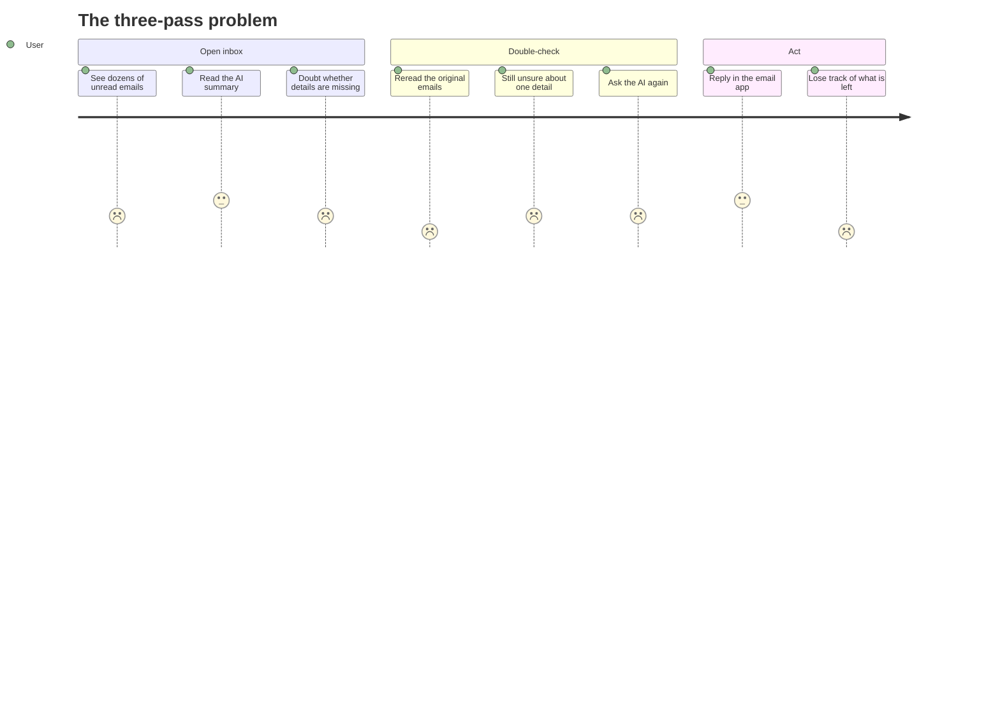
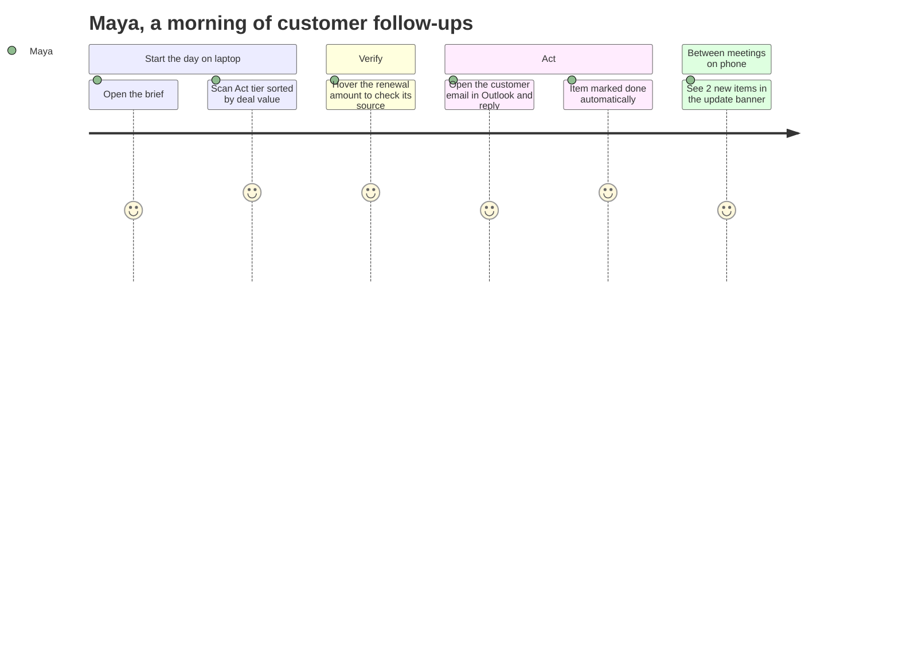
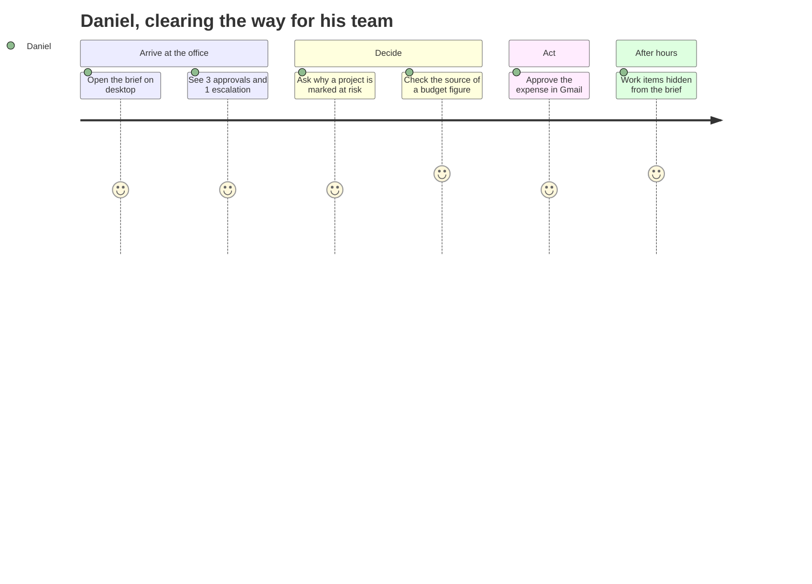
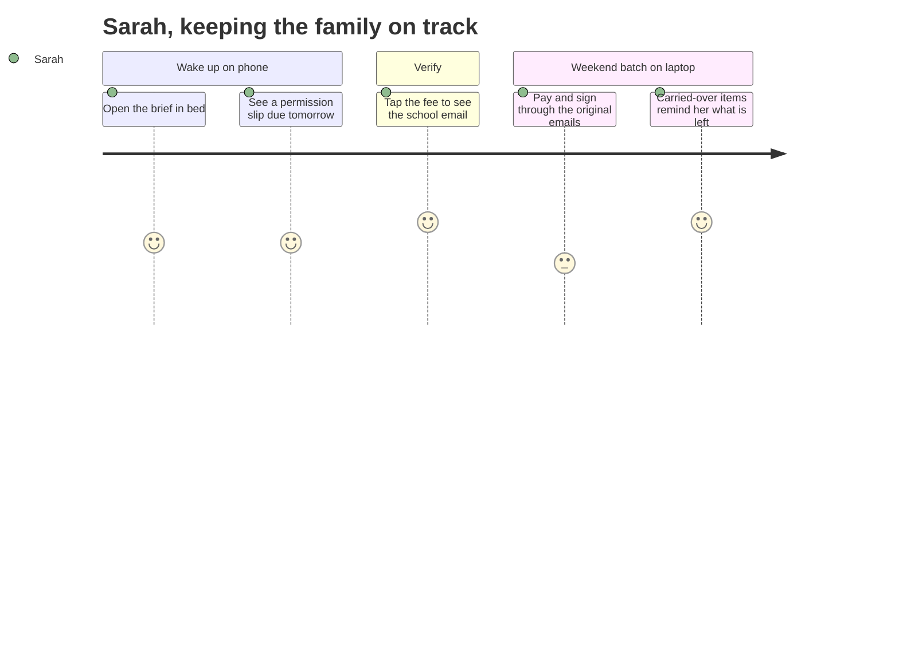
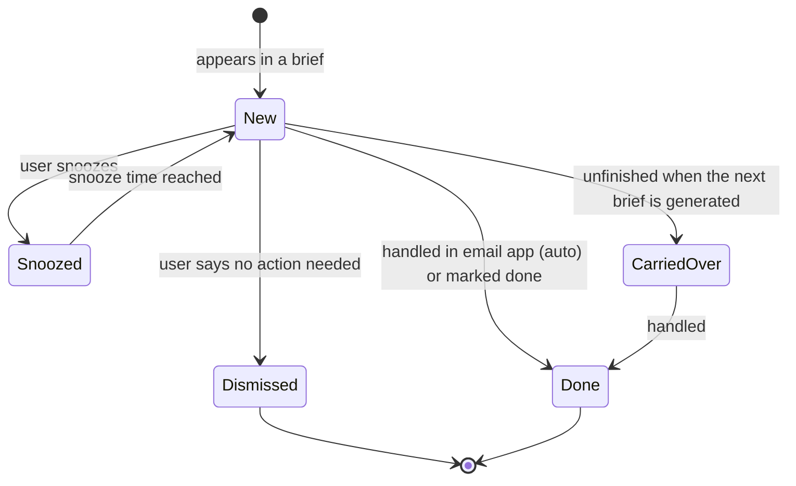
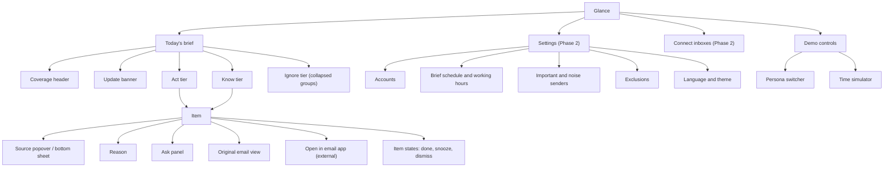
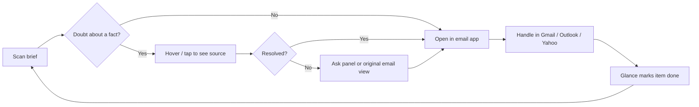

# Glance — Product Brief

**Status:** Draft v0.2
**Owner:** Shuhao Shang (Design)
**Last updated:** November 1, 2026

> Diagrams in this document are written in Mermaid and render automatically on GitHub.

---

## Contents

1. The problem
2. The thesis
3. What Glance is
4. Personas
5. Jobs to be done
6. User journeys
7. Design principles
8. Anatomy of a brief
9. Item lifecycle and closing the loop
10. Brief cadence and updates
11. Prioritization and personalization
12. Trust and accuracy
13. Accounts and privacy
14. Edge and system states
15. Information architecture
16. Design system architecture
17. Screens
18. Demo-only features
19. Accessibility and internationalization
20. How success would be measured
21. Scope
22. Open questions

---

## 1. The problem

AI email summaries were supposed to save time. In practice, they often add a step.

- **Compressed too much**, a summary loses the details that matter.
- **Compressed too little**, it is no faster than reading the original.
- Either way, there is **no quick way to verify** what the AI said. People don't trust AI with important things, so they read the original email anyway, and then ask the AI again about what's still unclear.

The result: one pass (read the email, maybe ask the AI) becomes three passes (read the summary, read the original, ask the AI again).

## 2. The thesis

> **Components make it fast. Sources make it trustworthy.**

- **Fast**: key information is shown through design-system components (amounts, deadlines, people, actions) instead of paragraphs.
- **Trustworthy**: every piece of information can be traced back to the exact sentence in the original email, in one gesture, without rereading the whole email.

## 3. What Glance is

Glance is an **AI briefing layer** on top of the user's existing inboxes. It is **not** a full email client.

- **Glance reads and briefs.** It tells the user what needs action, what they should know and what they can ignore, across all their connected inboxes.
- **The email app writes.** Replying, composing and searching stay in Gmail, Outlook or Yahoo Mail, which already have their own AI writing tools.
- **Glance keeps score.** When the user handles something in their email app, Glance detects it and marks the item as done. The loop closes through progress, not by doing everything in one place.

**Form:** a standalone, responsive web app for desktop and mobile browsers.

### Connecting inboxes

- Each inbox is connected once through the provider's official authorization (OAuth): Gmail, Outlook, Yahoo Mail; other providers through IMAP.
- Glance never sees the user's password. Access is **read-only** by default and can be revoked at any time from the provider's account settings.
- Multiple inboxes are combined into one brief. Every item shows which account it came from.
- *Production note:* reading Gmail requires passing Google's security review for restricted scopes. This is out of scope for the demo but a real cost for a shipped product.

## 4. Personas

### Maya — Sales / Customer Success

- Account manager at a B2B SaaS company, responsible for 30 customer accounts
- **Accounts:** work (Outlook)
- **When and where:** reads the brief on her laptop in the morning; checks her phone between meetings
- **Typical emails:** inquiries from potential customers, customer replies, renewal notices, meeting bookings, internal discount approvals, industry newsletters
- **Core question:** *Which customer must I follow up with today, and how much money is involved?*

### Daniel — Manager / Team Lead

- Design manager leading a team of 8
- **Accounts:** work (Google Workspace) and personal (Gmail)
- **When and where:** reads the brief on his desktop after arriving at the office; does not want to see work email after hours
- **Typical emails:** time-off and expense approvals, weekly project reports, escalations, interview feedback on candidates, lots of CC'd notifications
- **Core question:** *What needs my approval or decision, and which project is at risk?*

### Sarah — Family Manager

- Parent of two children
- **Accounts:** personal (Gmail) and an older family account (Yahoo Mail) that the school still uses
- **When and where:** reads the brief on her phone right after waking up; handles things in batches on her laptop on weekends
- **Typical emails:** school notices (permission slips, events, fees), after-school activity schedules, medical appointments, utility bills, deliveries, promotions
- **Core question:** *What does our family need me to handle this week?*

## 5. Jobs to be done

### Core job (all users)

> **When** my inboxes fill up, **I want to** know what needs me and trust that nothing important was missed, **so I can** act quickly and stop rereading.

### Persona jobs

| Persona | Main job | Emotional job | Social job |
|---|---|---|---|
| **Maya** | When I start my day, I want to see which customers need a follow-up and what is at stake, so I can protect revenue and respond before it is too late. | Feel in control of 30 accounts at once | Be seen by customers as responsive and reliable |
| **Daniel** | When I sit down at my desk, I want to clear approvals and spot project risks, so my team is never blocked by me. When I leave work, I want work to stay at work. | Confidence that no escalation slipped past | Be the manager who unblocks, not the bottleneck |
| **Sarah** | When I wake up, I want to know what the family needs this week, so forms, fees and appointments never slip. | Relief instead of background anxiety | Be the parent other people can count on |

### Supporting jobs (shared)

| Job | Glance feature |
|---|---|
| Check that a fact is right without rereading the email | Source on hover / tap |
| Understand why something is ranked as important | Reason on request |
| Know what is left to do | Coverage header with progress |
| Ignore noise without fear of missing something | Collapsed Ignore tier with counts |
| Get a specific question answered | Ask panel with sourced answers |

## 6. User journeys

### Today, without Glance

### With Glance — stages

| Stage | User is doing | User is thinking | Glance's role |
|---|---|---|---|
| **1. Trigger** | Starts the day / sits at desk / wakes up | "What's waiting for me?" | Brief is already generated |
| **2. Scan** | Reads the coverage header and Act tier | "How much is there? What's urgent?" | One screen, components, ~30 seconds |
| **3. Verify** | Hovers or taps a fact they doubt | "Is that amount really right?" | Source excerpt, original sentence highlighted |
| **4. Understand** | Asks why, or asks a follow-up | "Why is this marked urgent?" | Reason on request, Ask panel with sources |
| **5. Act** | Opens the email in their email app and handles it | "Let me just reply to this." | Deep link straight to the exact email |
| **6. Close** | Returns to Glance | "What's left?" | Item auto-marked done, progress updates |
| **7. Return** | Checks again later | "Did anything new come in?" | Update banner instead of a reshuffled brief |

### Maya

### Daniel

### Sarah

## 7. Design principles

1. **Small enough to be worth it.** The brief fits on one screen and can be read in about 30 seconds. Even if it turns out to be unnecessary, reading it should feel like no real cost.
2. **Quiet by default, sources on demand.** Sources are not displayed up front, because visible citations make the screen busy. Verifiable information carries a subtle visual hint; the source appears on hover (desktop) or tap (mobile, as a bottom sheet), with the original sentence highlighted. The faster a doubt is resolved, the more the user comes back.
3. **Extract, don't paraphrase.** Amounts, dates, names and explicit requests are taken from the email as written. Rewording is where trust is lost.
4. **Complete, not just correct.** Users must be able to see that nothing was missed: how many emails the brief covers, from which accounts, and what was filed under Ignore. Nothing disappears silently.
5. **Explain on request.** Any item can answer "why is this here?" (e.g. "due today, from your manager"), but only when asked.
6. **Stable while reading.** New emails never reshuffle a brief the user is reading. They arrive as a clearly marked update.
7. **Components only where the content has structure.** Emails with a stable structure are shown as components. Content without a stable structure falls back to clear typographic hierarchy. Knowing when **not** to use a component is part of the system.
8. **Motion explains change.** Animation is used to show state changes (an item completing and collapsing, new items arriving), never for decoration.

### Levels of AI output

| Level | Output form | Reader effort |
|---|---|---|
| L1 | Plain paragraphs | Highest |
| L2 | Typographic hierarchy: headings, lists, tables | Medium |
| L3 | Components chosen by rules | Lowest |

## 8. Anatomy of a brief

### Coverage header

Always visible at the top: what the brief covers and how far the user has got.

> *Covers 47 emails from 2 accounts since yesterday 8:00 · 3 of 5 actions done*

### Three tiers

1. **Act** — things that need the user to do something (reply, approve, sign, pay)
2. **Know** — things worth being aware of (status, schedules, progress)
3. **Ignore** — noise, collapsed by default with a count (promotions, CC'd notifications, newsletters)

This layout is a design-system pattern shared by all personas.

### Anatomy of an item

| Part | Visibility |
|---|---|
| Scene card (the content, built from primitives) | Always |
| Account indicator | Always, subtle |
| Primary action (e.g. Open in Gmail) | Always |
| Source excerpt | On hover / tap |
| Reason ("why is this here?") | On request |
| Ask a follow-up | On request |

## 9. Item lifecycle and closing the loop

| State | How it happens |
|---|---|
| **New** | Item appears in a brief |
| **Done (auto)** | Glance detects the user replied, paid or accepted in their email app |
| **Done (manual)** | User marks it done in Glance |
| **Snoozed** | User hides it until a chosen time; it returns to Act |
| **Dismissed** | User decides it does not need action; moves to Ignore |
| **Carried over** | An unfinished Act item from a previous brief appears in today's brief, marked as carried over |

Unfinished actions never fall out of the brief silently.

## 10. Brief cadence and updates

- A brief is generated on a schedule (e.g. every morning) and can be refreshed on demand.
- Emails that arrive after the brief was generated appear as an update ("4 new since 8:00"), not as a reshuffled brief.
- Per-account time rules: e.g. a work account's items are hidden after working hours (Daniel).

## 11. Prioritization and personalization

**Signals the AI uses to rank Act items:** deadline urgency, explicit requests to the user, sender importance, amount of money involved, and whether the user is waiting on it or someone is waiting on the user.

**User controls:**
- Mark senders as important (always surface) or noise (always Ignore)
- "Not important" and "Show me less like this" on any item
- Exclude senders or labels from AI processing entirely (e.g. medical or banking emails)

## 12. Trust and accuracy

- **Sources:** every extracted fact links to its original sentence (principle 2)
- **Verbatim extraction:** key facts are never reworded (principle 3)
- **Coverage:** the user can see the scope of each brief (principle 4)
- **Reasons:** the user can ask why any item is ranked where it is (principle 5)
- **Corrections:** if an extracted fact is wrong, the user can flag it; the item falls back to showing the original excerpt
- **Uncertainty:** the AI may flag ambiguity (e.g. two different deadlines in one email). See open questions.

## 13. Accounts and privacy

- Read-only access by default; any write action (e.g. accepting a meeting from Glance) would require a separate, explicit permission
- Users can disconnect any account at any time
- Users can exclude senders or labels from processing
- A plain-language explanation of what Glance stores and for how long, shown during connection

## 14. Edge and system states

| State | Behavior |
|---|---|
| **Nothing to act on** | A calm, positive empty state ("Nothing needs you today"), still showing coverage |
| **Overload day** | Act shows the top items that fit one screen, then "+6 more"; the one-screen rule holds |
| **First brief** | Short explanation of the three tiers and how to check sources |
| **Syncing** | Coverage header shows progress; partial results are clearly labeled |
| **Account disconnected / expired** | Inline banner on affected items with a reconnect action; other accounts keep working |
| **Mixed languages** | The brief uses the user's chosen language; extracted quotes stay in the original language |

## 15. Information architecture

### Site map

The design system documentation (Storybook) is a separate site: tokens, primitives, scene cards and patterns.

### Key flow: verify, then act

## 16. Design system architecture

Instead of designing separate cards for every persona, Glance builds a small set of **primitives** and composes them into **scene cards** and **patterns**.

### Tokens

Color, typography, spacing, radius, shadow and motion, with **light and dark themes** from the start.

### Primitives (shared by all personas)

| Primitive | Purpose |
|---|---|
| Amount | Money with status: due, paid, overdue, refunded |
| Deadline | Relative time with urgency: today, in 3 days, overdue |
| Person | Avatar, name, relationship or role |
| Status | Progress or state label |
| Action | Reply, accept, pay, open in email app |
| Source | Original excerpt, shown on hover or tap |
| Account | Which inbox an item came from |
| Collapsed group | Folds noise with a count |
| Text | Fallback for unstructured content (L2) |

### Scene cards (compositions of primitives)

| Persona | Scene cards |
|---|---|
| **Maya** | New lead · Customer reply summary · Renewal risk · Meeting booking · Discount approval status |
| **Daniel** | Approval request · Project status summary · Escalation alert · Decision needed · Candidate feedback |
| **Sarah** | School notice (date, sign or pay) · Appointment reminder · Bill / fee · Family schedule · Delivery tracking |

### Patterns

- Brief layout (coverage header + Act / Know / Ignore)
- Item states (new, done, snoozed, dismissed, carried over)
- Empty, overload, syncing and error states
- Source popover (desktop) and source bottom sheet (mobile)

## 17. Screens

### MVP

1. **Today's brief** — the core screen
2. **Source popover / bottom sheet** — original excerpt with highlighting
3. **Ask panel** — follow-up questions on a specific item; answers include sources (pre-written mock data)
4. **Original email view** — the full email with the sentences the AI used highlighted
5. **Design system** — Storybook documentation of tokens, primitives, scene cards and patterns

### Phase 2

6. **Connect inboxes** — onboarding flow with mock authorization
7. **Settings** — accounts, brief schedule, working hours, important and noise senders, exclusions, language and theme

## 18. Demo-only features

These exist to show the work, not as product features.

- **Persona switcher:** switch between Maya, Daniel and Sarah to see one design system adapt to three contexts
- **Time simulator:** move the clock forward to see new emails arrive as an update, items complete, and after-hours rules apply

## 19. Accessibility and internationalization

- WCAG AA contrast in both themes
- Full keyboard navigation on desktop; sources reachable by keyboard, not only by hover
- Screen reader labels for all primitives (e.g. Amount reads as "84 dollars 20, due in 3 days")
- Respects reduced-motion settings
- Layouts tolerate longer text and mixed languages

## 20. How success would be measured

If Glance were a real product:

- **Time to clarity:** how long until the user knows what they need to do today
- **Original-open rate:** how often users open the original email just to double-check (lower means more trust)
- **Source checks:** how often sources are opened, and whether that drops as trust builds
- **Action completion:** share of Act items done the same day
- **Return rate:** how many users read the brief on most workdays

## 21. Scope

- Front-end only, with mock data. No real email connection, no real AI calls.
- Responsive web for desktop and mobile browsers.
- Native iOS app is out of scope (may be shown as a Figma concept).

## 22. Open questions

- Should the brief include a toggle that shows the same content at L1, L2 and L3, to demonstrate the thesis directly?
- Should the demo include a "designer notes" mode that annotates the live interface with the reasoning behind design decisions?
- One combined brief for all accounts, or a switch between accounts? How do per-account time rules appear in the interface?
- Should some one-tap actions (accept meeting, approve expense) happen inside Glance in a later phase?
- How visible should uncertainty flags be without breaking principle 2?
- Default brief language when emails arrive in several languages?
- Visual language: to be defined after reference research.
