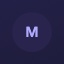
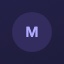

# Account menu and Appearance review

Task 30 implements [issue #62](https://github.com/shuhaoshang/glance-mail/issues/62).

## Screenshots

The captures show the focused System choice at desktop (1280 × 1000) and phone (390 × 844) widths. The browser emulates the color scheme and reduced motion.

| Persona | Desktop light | Desktop dark | Phone light | Phone dark |
| --- | --- | --- | --- | --- |
| Maya | [Light](maya-desktop-light.jpg) | [Dark](maya-desktop-dark.jpg) | [Light](maya-phone-light.jpg) | [Dark](maya-phone-dark.jpg) |
| Daniel | [Light](daniel-desktop-light.jpg) | [Dark](daniel-desktop-dark.jpg) | [Light](daniel-phone-light.jpg) | [Dark](daniel-phone-dark.jpg) |
| Sarah | [Light](sarah-desktop-light.jpg) | [Dark](sarah-desktop-dark.jpg) | [Light](sarah-phone-light.jpg) | [Dark](sarah-phone-dark.jpg) |

Compare the [previous desktop header](../29-memory/maya-desktop-light.jpg) and [previous phone header](../29-memory/maya-phone-dark.jpg) with [the desktop reference](../../screens/v2/account-menu.png) and [the phone reference](../../screens/v2/phone-account-menu.png). Issue #62 defines the current menu contents as identity and Appearance. The reference screens also show the entries planned for issue #63.

## How to review

1. Open Patterns / Account menu / Maya and select Light or Dark. The palette and checked selection update while the menu is open.
2. On the app, reload after selecting a theme. The preference returns with the same checked choice. Select System and emulate a different OS color scheme to confirm that the palette follows it.
3. Open the menu from the avatar with Enter. Arrow keys move focus between choices. Enter and Space apply the focused choice. Escape, Tab, an outside click, and focus leaving the menu return focus to the avatar.
4. At 390 wide, the Appearance label sits above three equal-width, 44-pixel segments. Check Daniel and Sarah for the corresponding avatar and email.
5. Expand the demo bar and check the persona, level, and Simulate reply controls.

## Review follow-up

The account menu stays open after each Appearance choice so people can compare themes. Move to closes when its action runs. The avatar trigger uses the brand tint hover and pressed tokens and the shared keyboard focus ring.

| Avatar state | Light | Dark |
| --- | --- | --- |
| Previous fill and current rest |  |  |
| Hover |  |  |
| Pressed |  |  |

Storybook shows both pointer states under Composites / AccountMenu. The browser checks confirmed the tokens, keyboard focus ring, and menu behavior at 1280 and 390 in light and dark.

## Open questions

None. The review approved both behaviors. [Review comment](https://github.com/shuhaoshang/glance-mail/pull/75#issuecomment-6893629243)
