# Glance — User flows

**Status:** v1.0 (design handoff)  
**Last updated:** November 3, 2026  
**Related:** [Product brief](product-brief.md) §5–6 · [Design rules](design-rules.md) · [Design system](design-system.md) · [Data model](data-model.md) · [Issue 16: end-to-end tests](handoff/issues/16-e2e-flows.md)

Each persona’s story, walked end to end on the real screens. Design used these walks to find missing states; the steps below are also the acceptance criteria for the app. The same flows are on the design canvas as Round 11 (one board per persona).

## How to read this

- **One step = one screen state.** Each step names the screen, what the person does and thinks, what Glance does, and the rule it proves.
- **Screenshots:** the part that matters is outlined in purple; the rest is dimmed. Files are in [`screens/flows/`](screens/flows/).
- **Given / When / Then** blocks are acceptance criteria. [Issue 16](handoff/issues/16-e2e-flows.md) turns them into Playwright tests. Text in quotes is exact copy from `src/data/*.json` or the named pattern.
- **Start state:** every flow starts clean. `/?persona=<id>&start=clean` ignores `demo.initialSelection`, so no source or reason is open. Desktop flows run at 1280 × 800, phone flows at 390 × 844. Viewport checks measure the product only; the Demo controls above it are not part of the product.
- **Patterns:** steps marked *pattern* (quiet hours, disconnected, overload) are Storybook stories from issue 13, not app routes.
- **Branches** are other paths through the same moment. They are tested like steps.

## Stages

All three flows use the same stages. Not every persona needs every stage.

| Stage | The person | Glance |
|---|---|---|
| **Open and scan** | Opens the brief; reads the coverage line and Needs you | One screen, ranked by urgency, then value; already-done items shown as done |
| **Verify** | Selects a value they doubt | Opens the exact sentence, the words highlighted by type |
| **Understand** | Asks why it is here | “Glance’s read”: the ranking reason and judgments, each with evidence, and “Move to Set aside” if it isn’t for them |
| **Ask** | Asks a follow-up question | Answers only from email, with the source, or says “Not in your email” |
| **Act** | Reads the original, then handles it in the email app or another tool | Highlights what it used; hands off with one primary action |
| **Close** | Comes back | Marks it done (reply detected, or by hand); progress moves; Undo is always there |
| **Return** | Checks again later | New mail waits in a row; nothing reshuffles until they add it |
| **Tidy** | Checks what was set aside | “Show in brief” moves an email to Good to know and teaches Glance |
| **After hours** | Looks at the phone in the evening | Shows only what the account rules allow, and says what is waiting |

## Contents

1. [Maya — protect a renewal before Friday](#1-maya--protect-a-renewal-before-friday)
2. [Daniel — unblock the team, keep the evening](#2-daniel--unblock-the-team-keep-the-evening)
3. [Sarah — clear the family’s to-dos before getting up](#3-sarah--clear-the-familys-to-dos-before-getting-up)
4. [What walking the flows changed](#4-what-walking-the-flows-changed)


> **Visual 2.0.** The stories are the same; the screens they run on changed (decisions D47 to D61). Section “Visual 2.0” at the end rewrites the steps that changed and adds new ones. Where it disagrees with a step above, it wins. The step images above show the earlier design.
---

## 1. Maya — protect a renewal before Friday

**Job:** When I start my day, I want to see which customers need a follow-up and what is at stake, so I can protect revenue and respond before it is too late.

- **Device and inboxes:** Laptop · Outlook
- **Data:** `src/data/maya.json` · **Prototype:** [`prototype/maya.html`](prototype/maya.html) · **Canvas:** Round 11, MayaFlow
- **Story:** Maya protects a renewal before Friday’s review, checks a discount without leaving Glance, and handles new mail without losing her place.

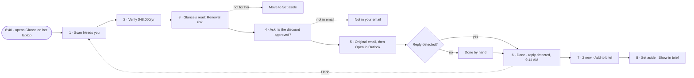

| # | Stage | Screen and state | Rule |
|---|---|---|---|
| 1 | Open and scan | Desktop brief · Fernway selected | Urgency first, then value. Solid pink means urgent. The brief fits one screen. |
| 2 | Verify | Desktop · Details · source open on $48,000/yr | Every underlined value opens the exact words it came from. |
| 3 | Understand | Desktop · Details · Glance’s read open | Judgments carry ✦ and always show their evidence. |
| 4 | Ask | Desktop · Ask tab | Answers come only from email; otherwise “Not in your email”. |
| 5 | Act | Desktop · Original email tab | Glance reads and briefs; the email app writes. |
| 6 | Close | Desktop brief · Fernway done (reply detected) | Glance keeps score. Undo is always there. |
| 7 | Return | Desktop brief · new mail added · Okto selected | The brief never reshuffles on its own. |
| 8 | Tidy | Desktop · Set aside view | Nothing disappears silently. |

### Maya 1 · Open and scan: Sees what can’t wait

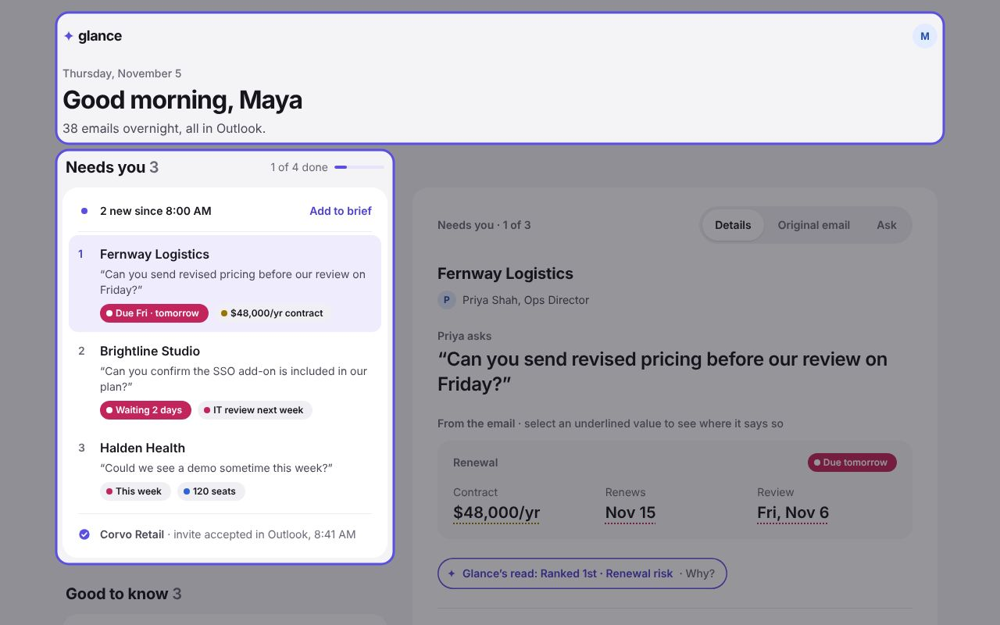

- **Maya does:** Opens Glance on her laptop at 8:40, before her first call.
- **Maya thinks:** “What can’t wait until after lunch?”
- **Glance does:** 38 emails became 3 items. Fernway is first: due tomorrow and the largest account. Corvo is already done: Glance saw she accepted the invite in Outlook.
- **Rule:** Urgency first, then value. Solid pink means urgent. The brief fits one screen.

```gherkin
Scenario: Maya sees what can’t wait
  Given Maya’s brief is open on a 1280 × 800 screen
  Then the coverage line reads "38 emails overnight, all in Outlook."
  And "Needs you" shows 3 items in this order: "Fernway Logistics", "Brightline Studio", "Halden Health"
  And Fernway Logistics shows the chips "Due Fri · tomorrow" (solid pink) and "$48,000/yr contract"
  And the progress reads "1 of 4 done"
  And a done row reads "Corvo Retail · invite accepted in Outlook, 8:41 AM"
  And Fernway Logistics is selected and its detail shows the "Renewal" scene card
```

### Maya 2 · Verify: Checks the contract value

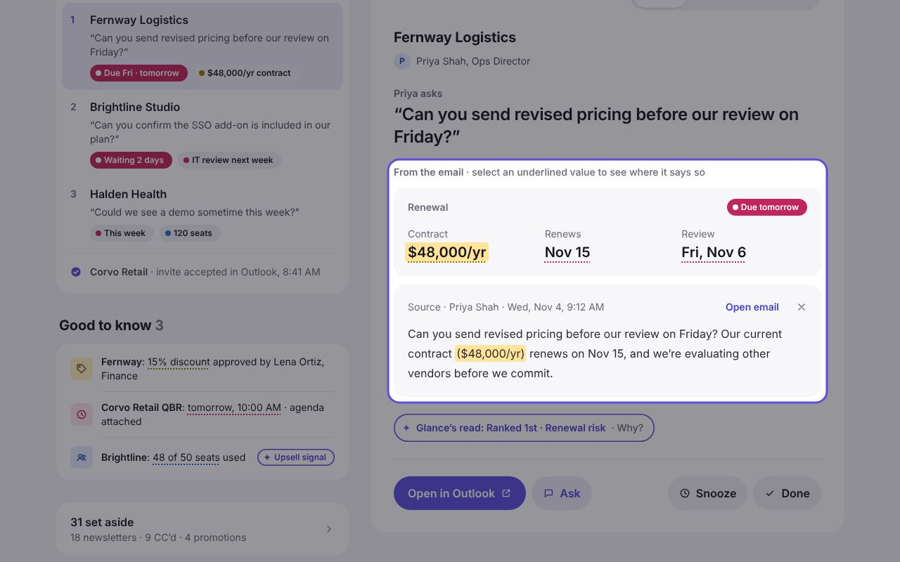

- **Maya does:** Selects $48,000/yr in the renewal card.
- **Maya thinks:** “Is that this year’s figure, or last year’s $44,000?”
- **Glance does:** Opens Priya’s sentence with the amount highlighted in money ink.
- **Rule:** Every underlined value opens the exact words it came from.

```gherkin
Scenario: Maya checks the contract value
  Given Fernway Logistics is selected
  When she selects "$48,000/yr" in the Renewal card
  Then the value is inked in money yellow and pressed
  And a source panel opens: "Source · Priya Shah · Wed, Nov 4, 9:12 AM"
  And the sentence shows "($48,000/yr)" highlighted
  When she selects "$48,000/yr" again, or presses "Close source"
  Then the source panel closes
```

### Maya 3 · Understand: Learns why it’s at risk

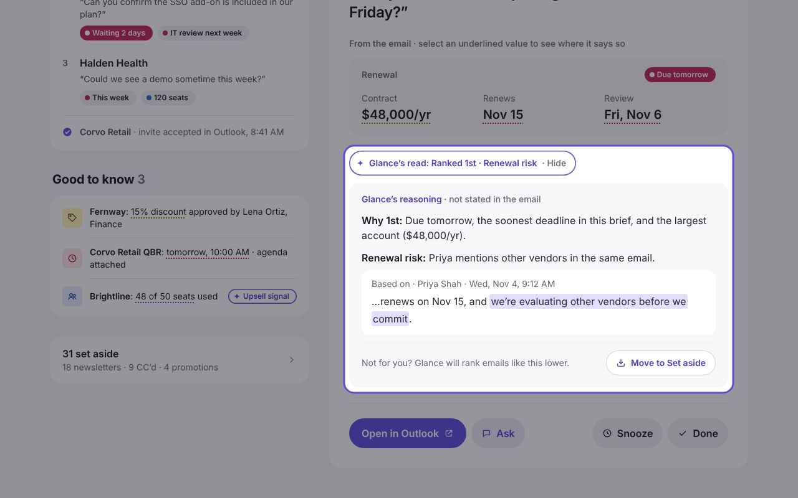

- **Maya does:** Opens Glance’s read.
- **Maya thinks:** “Why is this flagged as a risk?”
- **Glance does:** Ranked 1st · Renewal risk, with the evidence: “we’re evaluating other vendors before we commit.” If it weren’t hers, Move to Set aside is right there.
- **Rule:** Judgments carry ✦ and always show their evidence.

```gherkin
Scenario: Maya learns why Fernway is at risk
  Given Fernway Logistics is selected
  When she opens "Glance’s read: Ranked 1st · Renewal risk"
  Then she sees "Glance’s reasoning · not stated in the email"
  And "Why 1st:" with the ranking reason
  And "Renewal risk:" with the evidence "we’re evaluating other vendors before we commit" from Priya Shah, highlighted in judgment ink
  And nothing Glance wrote appears inside the Renewal card
  And the panel ends with "Not for you? Glance will rank emails like this lower." and "Move to Set aside"
```

### Maya 4 · Ask: Confirms the discount

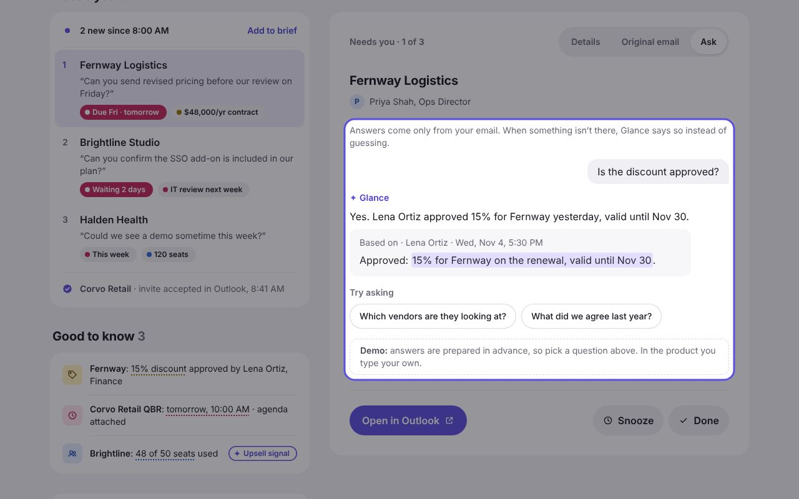

- **Maya does:** Asks: “Is the discount approved?”
- **Maya thinks:** “Can I offer the 15% Lena mentioned?”
- **Glance does:** Yes, 15% approved by Lena Ortiz, valid until Nov 30, with Lena’s email as the source.
- **Rule:** Answers come only from email; otherwise “Not in your email”.

```gherkin
Scenario: Maya asks whether the discount is approved
  Given Fernway Logistics is selected
  When she opens the Ask tab and picks "Is the discount approved?"
  Then the answer reads "Yes. Lena Ortiz approved 15% for Fernway yesterday, valid until Nov 30."
  And it is marked with ✦ Glance and shows "Based on · Lena Ortiz · Wed, Nov 4, 5:30 PM"
  And the suggestion she used is no longer offered
  When she asks "Which vendors are they looking at?"
  Then the reply is titled "Not in your email" and shows no source
```

### Maya 5 · Act: Replies in Outlook

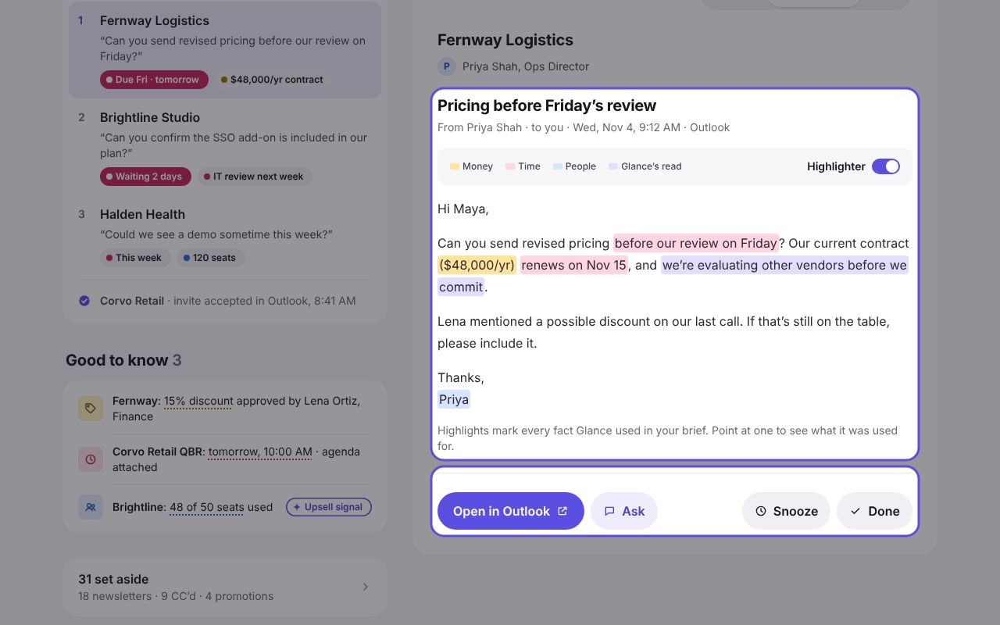

- **Maya does:** Skims the whole email, then Open in Outlook and sends revised pricing with the discount.
- **Maya thinks:** “Let me just answer her.”
- **Glance does:** Highlights every fact it used, then hands off to Outlook.
- **Rule:** Glance reads and briefs; the email app writes.

```gherkin
Scenario: Maya reads the original and goes to Outlook
  Given Fernway Logistics is selected
  When she opens the "Original email" tab
  Then the subject reads "Pricing before Friday’s review"
  And every fact Glance used is highlighted by type (money, time, people, Glance’s read)
  And the Highlighter switch is on and can turn the ink off
  And "Open in Outlook" is the only primary button and opens the Outlook web inbox in a new tab
```

### Maya 6 · Close: Glance notices the reply

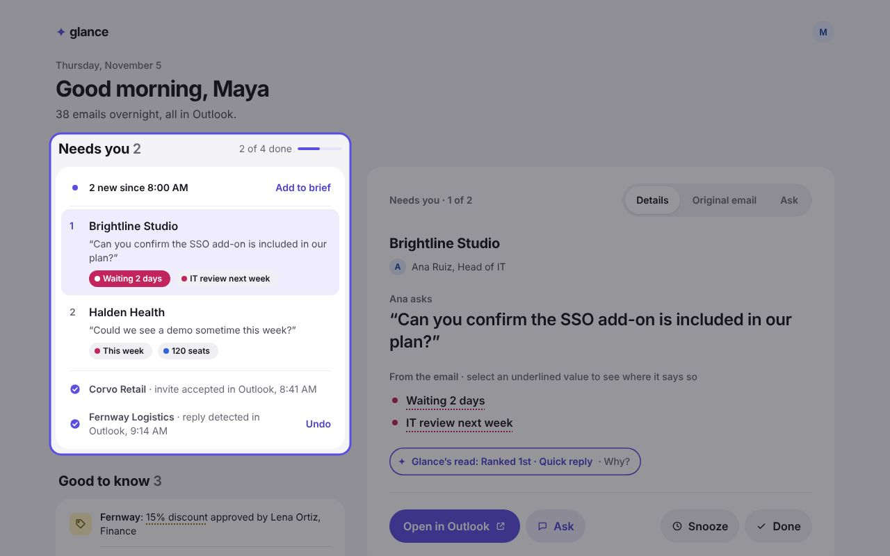

- **Maya does:** Comes back to Glance.
- **Maya thinks:** “What’s left?”
- **Glance does:** Fernway is done (“reply detected in Outlook, 9:14 AM”), progress is 2 of 4, and Brightline is selected next.
- **Rule:** Glance keeps score. Undo is always there.

```gherkin
Scenario: Glance notices Maya’s reply
  Given Fernway Logistics is open in Needs you
  When "Simulate reply to Priya" is pressed in the demo controls
  Then Fernway Logistics leaves Needs you within 320 ms
  And a done row reads "Fernway Logistics · reply detected in Outlook, 9:14 AM" with Undo
  And the progress reads "2 of 4 done"
  And Brightline Studio is selected
  When she presses Undo on the Fernway row
  Then Fernway Logistics returns to rank 1 and the progress reads "1 of 4 done"
```

### Maya 7 · Return: Adds new mail on her terms

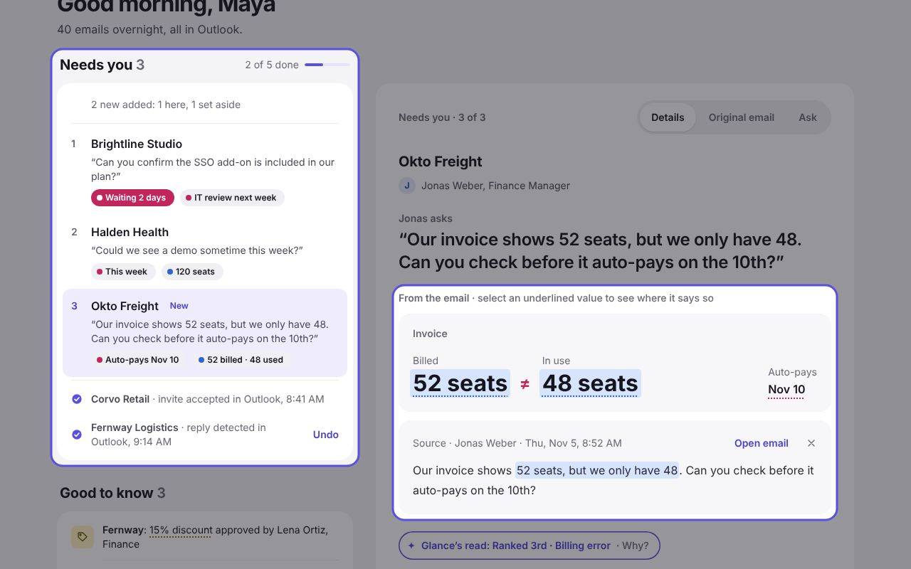

- **Maya does:** Sees “2 new since 8:00 AM” and adds them.
- **Maya thinks:** “Did anything new come in?”
- **Glance does:** Okto joins at the end, marked New. Its card shows 52 seats billed against 48 in use. The newsletter goes to Set aside.
- **Rule:** The brief never reshuffles on its own.

```gherkin
Scenario: Maya adds the new mail
  Given Fernway Logistics is done
  And the first row of Needs you reads "2 new since 8:00 AM" with "Add to brief"
  When she presses "Add to brief"
  Then the row reads "2 new added: 1 here, 1 set aside"
  And "Okto Freight" joins at rank 3, after the existing items, marked "New"
  And the coverage line reads "40 emails overnight, all in Outlook."
  And the progress reads "2 of 5 done"
  When she selects Okto Freight
  Then its "Invoice" card shows "52 seats" ≠ "48 seats" and "Auto-pays Nov 10"
  And no item that was already listed changes its rank
```

### Maya 8 · Tidy: Keeps one newsletter

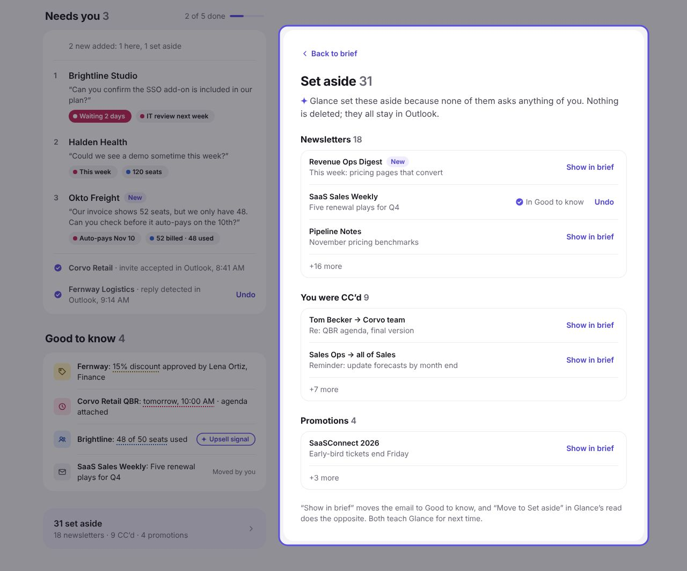

- **Maya does:** Opens Set aside and keeps SaaS Sales Weekly.
- **Maya thinks:** “Did Glance hide anything I want?”
- **Glance does:** Moves it to Good to know, marked “Moved by you”, and learns for next time.
- **Rule:** Nothing disappears silently.

```gherkin
Scenario: Maya keeps one newsletter
  Given the new mail was added
  When she opens Set aside
  Then the title reads "Set aside 32" and Newsletters reads 19
  When she presses "Show in brief" on "SaaS Sales Weekly"
  Then the row reads "In Good to know" with Undo
  And Set aside reads 31 and Newsletters 18
  And Good to know reads 4 and ends with "SaaS Sales Weekly: Five renewal plays for Q4", marked "Moved by you"
  And Needs you + Good to know + Set aside + done still add up to 40
```

---

## 2. Daniel — unblock the team, keep the evening

**Job:** When I sit down at my desk, I want to clear approvals and spot project risks, so my team is never blocked by me. When I leave work, I want work to stay at work.

- **Device and inboxes:** Desktop at work, phone in the evening · Gmail, Work and Personal
- **Data:** `src/data/daniel.json` · **Prototype:** [`prototype/daniel.html`](prototype/daniel.html) · **Canvas:** Round 11, DanielFlow
- **Story:** Daniel unblocks his team with one decision, approves an expense with the facts in front of him, catches a holiday clash across two emails, and keeps his evening free.

```mermaid
flowchart LR
  A(["9:05 · sits down at his desk"]) --> S1["1 · Scan Needs you"]
  S1 --> S2["2 · Compare option A and B"]
  S2 --> S3["3 · Glance’s read: Blocks your team"]
  S3 --> S4["4 · Ask: How long would saved cards take?"]
  S4 --> S5["5 · Replies to Sam in Gmail · reply detected"]
  S5 --> S6["6 · Expense: approve in the expense tool, then Done"]
  S6 --> S7["7 · Lea: overlaps Omar’s request"]
  S7 --> E(["8:30 PM · picks up his phone"])
  E --> S8["8 · Quiet hours: personal only"]
  S8 -. "Show work email anyway" .-> W["Tonight’s work email"]
```

| # | Stage | Screen and state | Rule |
|---|---|---|---|
| 1 | Open and scan | Desktop brief · Checkout selected | Account labels mark the exception, not the rule. |
| 2 | Decide | Desktop · Decision card · source open on option B | The detail view uses the scene card that matches the email’s structure. |
| 3 | Understand | Desktop · Details · Glance’s read open | Cards hold facts; judgments live in Glance’s read. |
| 4 | Ask | Desktop · Ask tab | Answers come with their source. |
| 5 | Act and close | Desktop brief · Checkout done (reply detected) | The loop closes through progress. |
| 6 | Approve | Desktop · Approval card · source open on $1,840 | No pretend actions: Glance never approves on his behalf. |
| 7 | Connect | Desktop · Time off card · Glance’s read open | Cross-email judgments show where they came from. |
| 8 | After hours | Phone · Quiet hours pattern *(pattern)* | Per-account rules sit under the coverage line. |

### Daniel 1 · Open and scan: Sees who is waiting on him

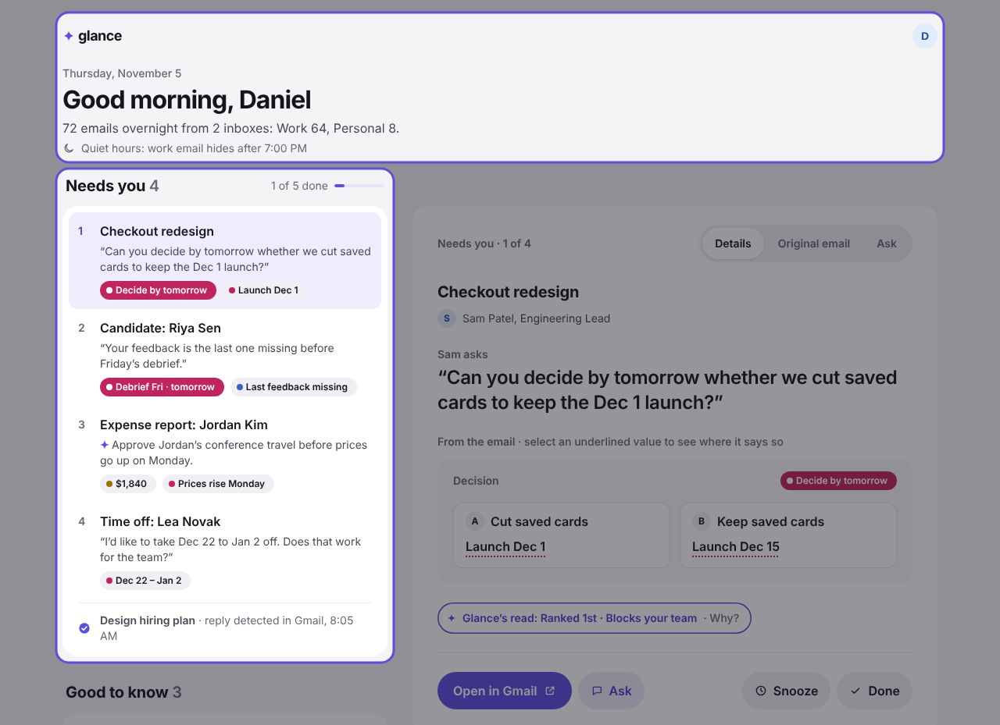

- **Daniel does:** Sits down at 9:05 and scans four items.
- **Daniel thinks:** “Who is blocked by me?”
- **Glance does:** 72 emails from 2 inboxes. Only the Personal item is labeled. The hiring-plan reply was already detected.
- **Rule:** Account labels mark the exception, not the rule.

```gherkin
Scenario: Daniel sees who is waiting on him
  Given Daniel’s brief is open on a 1280 × 800 screen
  Then the coverage line reads "72 emails overnight from 2 inboxes: Work 64, Personal 8."
  And under it: "Quiet hours: work email hides after 7:00 PM"
  And "Needs you" shows 4 items in this order: "Checkout redesign", "Candidate: Riya Sen", "Expense report: Jordan Kim", "Time off: Lea Novak"
  And no Needs you row shows an account label (all four are Work)
  And "Car service booked for Sat, 9:00 AM" in Good to know is labeled "Personal"
  And a done row reads "Design hiring plan · reply detected in Gmail, 8:05 AM"
```

### Daniel 2 · Decide: Compares the two options

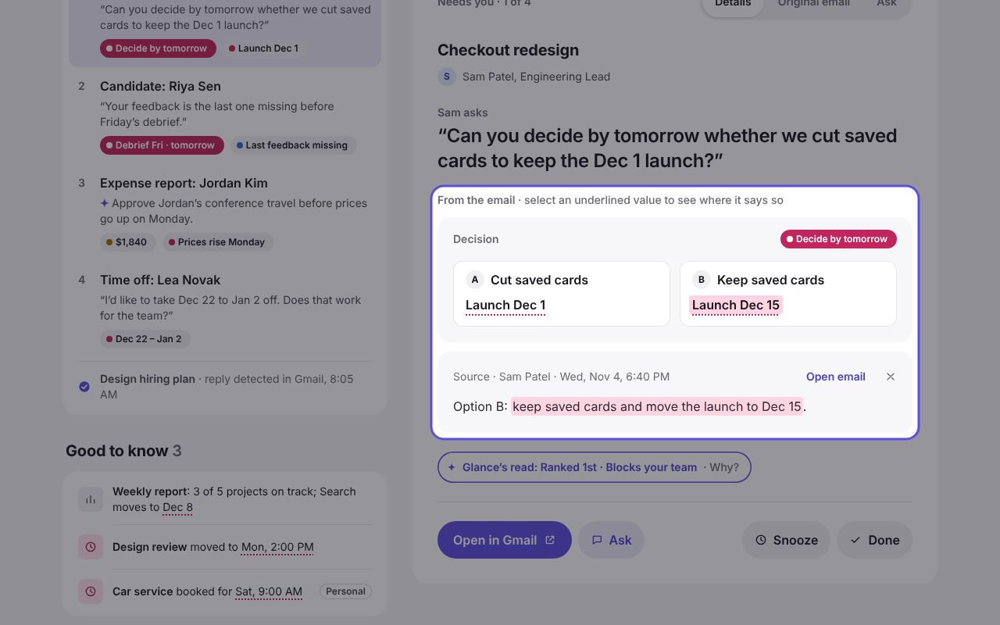

- **Daniel does:** Compares option A and B and checks option B’s exact wording.
- **Daniel thinks:** “What exactly am I choosing between?”
- **Glance does:** The decision card puts both options side by side. Selecting “Launch Dec 15” highlights Sam’s sentence.
- **Rule:** The detail view uses the scene card that matches the email’s structure.

```gherkin
Scenario: Daniel compares the two options
  Given Checkout redesign is selected
  Then the "Decision" card shows option A "Cut saved cards · Launch Dec 1" and option B "Keep saved cards · Launch Dec 15" side by side
  And the card header shows the urgent chip "Decide by tomorrow"
  When he selects "Launch Dec 15"
  Then the source panel shows Sam Patel’s sentence with "keep saved cards and move the launch to Dec 15" highlighted
```

### Daniel 3 · Understand: Sees what it blocks

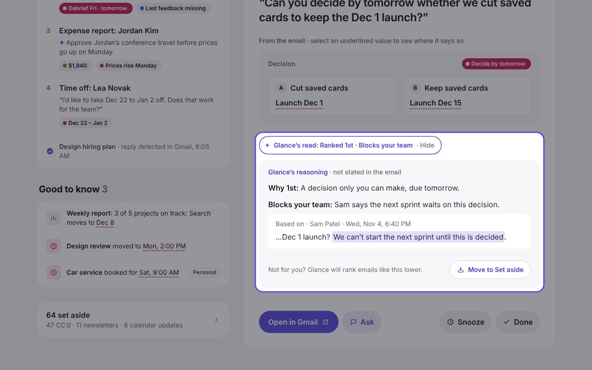

- **Daniel does:** Opens Glance’s read.
- **Daniel thinks:** “How urgent is this really?”
- **Glance does:** Blocks your team, with the evidence: “We can’t start the next sprint until this is decided.”
- **Rule:** Cards hold facts; judgments live in Glance’s read.

```gherkin
Scenario: Daniel sees what the decision blocks
  Given Checkout redesign is selected
  When he opens "Glance’s read: Ranked 1st · Blocks your team"
  Then "Blocks your team:" shows the evidence "We can’t start the next sprint until this is decided" from Sam Patel
```

### Daniel 4 · Ask: Checks the cost of waiting

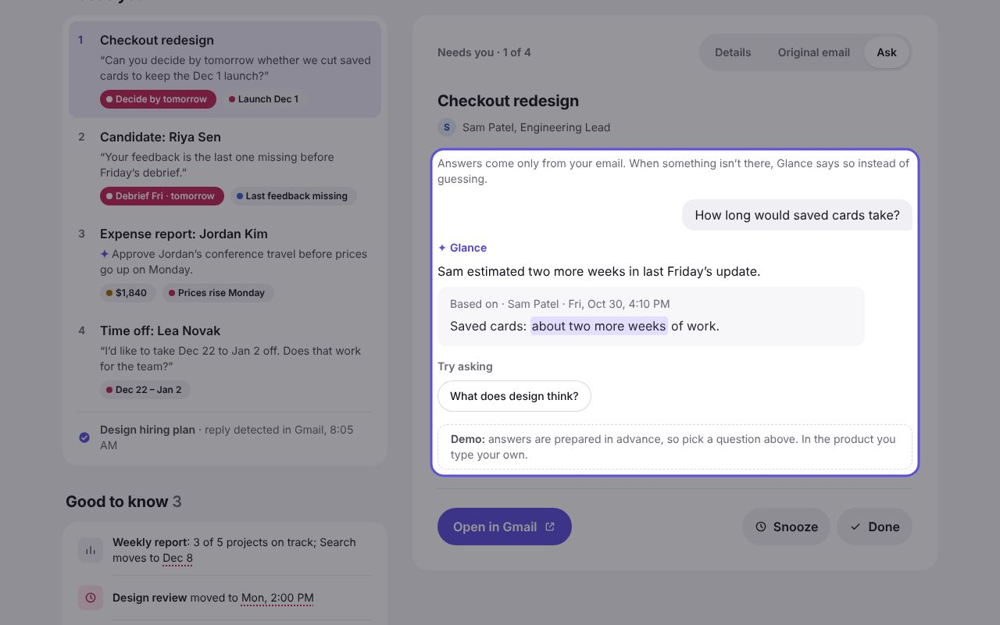

- **Daniel does:** Asks: “How long would saved cards take?”
- **Daniel thinks:** “Is option B worth two weeks?”
- **Glance does:** About two more weeks, from Sam’s update last Friday.
- **Rule:** Answers come with their source.

```gherkin
Scenario: Daniel checks the cost of option B
  Given Checkout redesign is selected
  When he asks "How long would saved cards take?"
  Then the answer reads "Sam estimated two more weeks in last Friday’s update."
  And the source shows "Based on · Sam Patel · Fri, Oct 30, 4:10 PM" with "about two more weeks" highlighted
```

### Daniel 5 · Act and close: Replies; Glance closes it

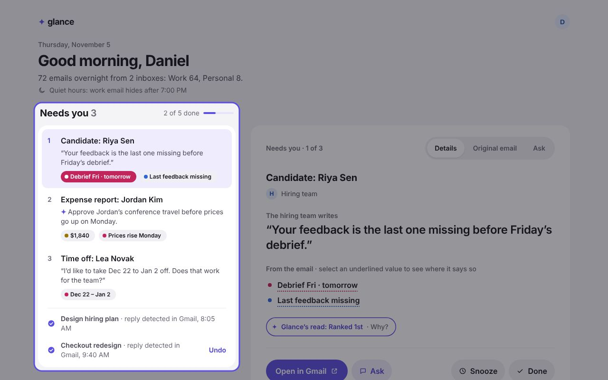

- **Daniel does:** Replies to Sam in Gmail: go with option A.
- **Daniel thinks:** “Done, next.”
- **Glance does:** Detects the reply and marks the decision done. Riya’s feedback is selected next.
- **Rule:** The loop closes through progress.

```gherkin
Scenario: Glance closes the decision after Daniel replies
  Given Checkout redesign is open
  When "Simulate reply to Sam" is pressed in the demo controls
  Then a done row reads "Checkout redesign · reply detected in Gmail, 9:40 AM" with Undo
  And the progress reads "2 of 5 done"
  And "Candidate: Riya Sen" is selected
```

### Daniel 6 · Approve: Approves with the facts in view

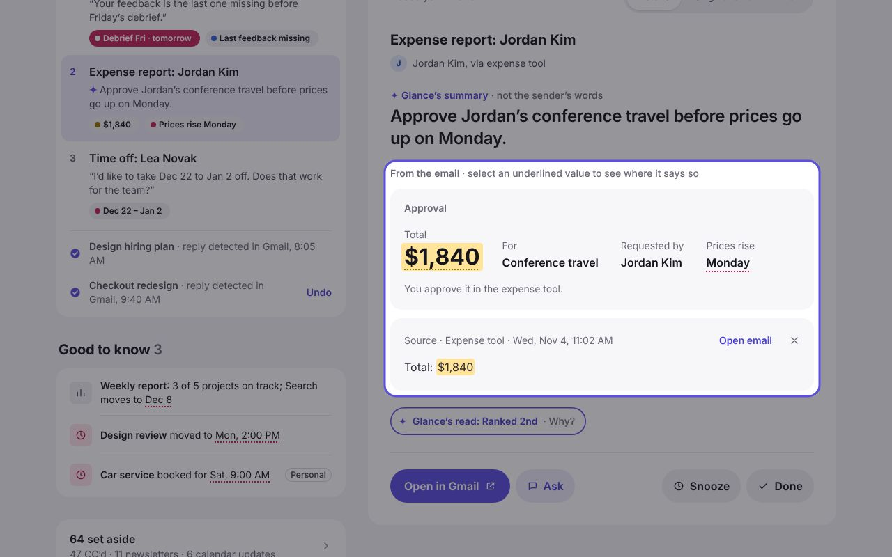

- **Daniel does:** Checks the $1,840, approves it in the expense tool, then marks it done.
- **Daniel thinks:** “Is this the right amount?”
- **Glance does:** The approval card shows the amount, purpose, requester and deadline, and says approval happens in the expense tool.
- **Rule:** No pretend actions: Glance never approves on his behalf.

```gherkin
Scenario: Daniel approves the expense with the facts in view
  Given he selects "Expense report: Jordan Kim"
  Then the "Approval" card shows Total "$1,840", For "Conference travel", Requested by "Jordan Kim", Prices rise "Monday"
  And the note reads "You approve it in the expense tool."
  And Glance offers no Approve button
  When he presses Done
  Then a done row reads "Expense report: Jordan Kim · marked done in Glance" with Undo
  And the progress reads "3 of 5 done"
```

### Daniel 7 · Connect: Catches a holiday clash

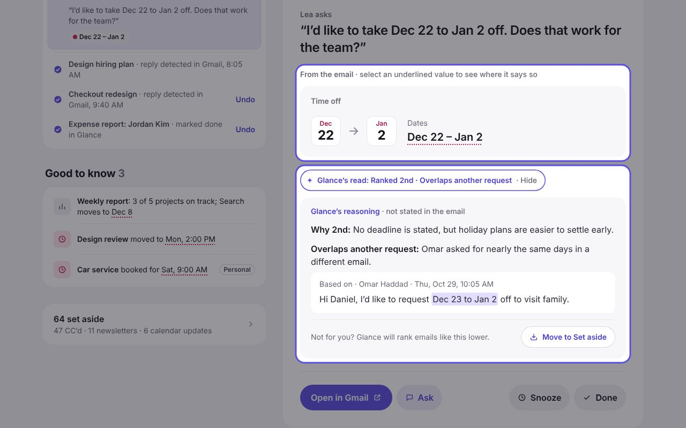

- **Daniel does:** Opens Lea’s time-off request.
- **Daniel thinks:** “Can the team cover those dates?”
- **Glance does:** Overlaps another request: Omar asked for Dec 23 – Jan 2 in a different email, shown as evidence.
- **Rule:** Cross-email judgments show where they came from.

```gherkin
Scenario: Daniel catches the holiday clash
  Given he selects "Time off: Lea Novak"
  Then the "Time off" card shows Dec 22 → Jan 2 and the dates "Dec 22 – Jan 2"
  When he opens "Glance’s read: Ranked 2nd · Overlaps another request"
  Then the evidence comes from a different email: Omar Haddad, Thu, Oct 29, 10:05 AM, with "Dec 23 to Jan 2" highlighted
```

### Daniel 8 · After hours: Work stays at work

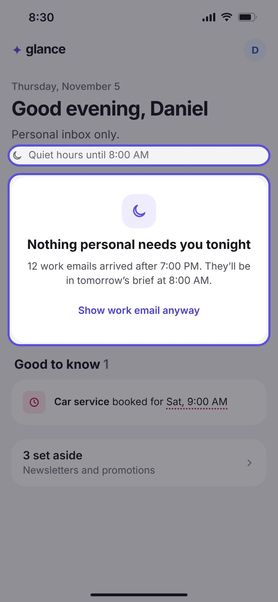

- **Daniel does:** Glances at his phone at 8:30 PM.
- **Daniel thinks:** “Is there anything I have to deal with tonight?”
- **Glance does:** Quiet hours: only the Personal inbox. 12 work emails will be in tomorrow’s brief, with a way to peek.
- **Rule:** Per-account rules sit under the coverage line.

```gherkin
Scenario: Daniel’s evening stays personal
  Given the "Quiet hours" pattern on a 390 × 844 phone, at 8:30 PM
  Then the heading reads "Good evening, Daniel" and the coverage line "Personal inbox only."
  And a quiet-hours label reads "Quiet hours until 8:00 AM"
  And the calm card reads "Nothing personal needs you tonight" and "12 work emails arrived after 7:00 PM. They’ll be in tomorrow’s brief at 8:00 AM."
  And "Show work email anyway" is a working text button, not the primary
  And Good to know shows 1 item and the Set aside row reads "3 set aside"
  And no work item appears anywhere on the screen
```

---

## 3. Sarah — clear the family’s to-dos before getting up

**Job:** When I wake up, I want to know what the family needs this week, so forms, fees and appointments never slip.

- **Device and inboxes:** Phone · Gmail (Personal) and Yahoo Mail (Family)
- **Data:** `src/data/sarah.json` · **Prototype:** [`prototype/phone/brief.html`](prototype/phone/brief.html) · **Canvas:** Round 11, SarahFlow
- **Story:** Sarah handles a school form and a clinic reminder before getting out of bed, and Glance stays honest when an inbox drops out or a week piles up.

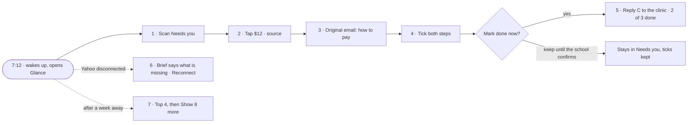

| # | Stage | Screen and state | Rule |
|---|---|---|---|
| 1 | Wake and scan | Phone brief | One screen, about 30 seconds. |
| 2 | Verify | Phone · detail sheet · source open on $12 | Facts in the card, the source one tap away. |
| 3 | Read the original | Phone · Original email | Highlighter on by default; one switch turns it off. |
| 4 | Act | Phone · detail sheet · both steps ticked | One primary per view, and it follows her next step. |
| 5 | Close | Phone brief · 2 of 3 done | Glance keeps score across both inboxes. |
| 6 | If an inbox drops out *(branch)* | Phone · Disconnected pattern *(pattern)* | A partial brief never looks complete. |
| 7 | After a week away *(branch)* | Phone · Overload pattern *(pattern)* | Needs you keeps to one screen. |

### Sarah 1 · Wake and scan: Sees what Ella needs

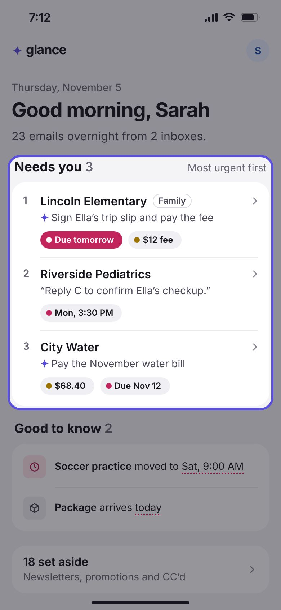

- **Sarah does:** Opens Glance in bed at 7:12.
- **Sarah thinks:** “Anything for Ella today?”
- **Glance does:** 23 emails from 2 inboxes became 3 items. The school form, from her Family inbox, is due tomorrow.
- **Rule:** One screen, about 30 seconds.

```gherkin
Scenario: Sarah sees what Ella needs
  Given Sarah’s brief is open on a 390 × 844 phone
  Then the coverage line reads "23 emails overnight from 2 inboxes."
  And "Needs you 3" shows "Lincoln Elementary", "Riverside Pediatrics", "City Water", most urgent first
  And only Lincoln Elementary shows an account label: "Family"
  And Lincoln Elementary’s request reads "✦ Sign Ella’s trip slip and pay the fee" with the solid chip "Due tomorrow"
  And everything up to the Set aside row fits on one screen
```

### Sarah 2 · Verify: Checks the fee

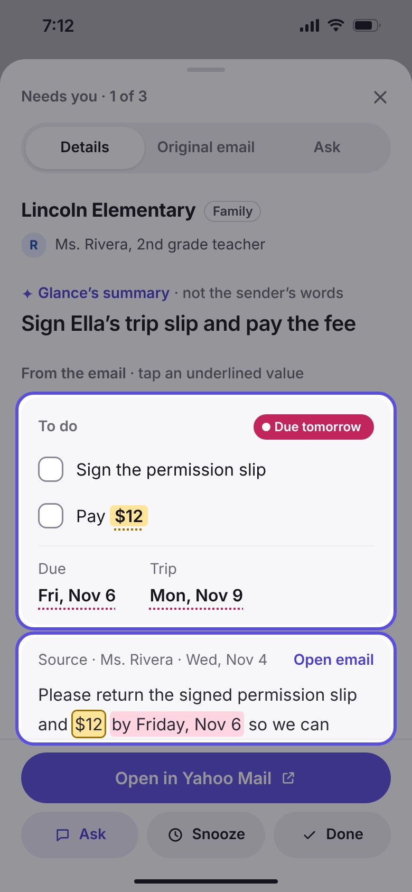

- **Sarah does:** Taps the school item, then $12.
- **Sarah thinks:** “How much, and by when?”
- **Glance does:** A to-do card with both steps. The teacher’s sentence opens with $12 highlighted.
- **Rule:** Facts in the card, the source one tap away.

```gherkin
Scenario: Sarah checks the fee
  Given she taps Lincoln Elementary
  Then a detail sheet opens with "Needs you · 1 of 3" and the "To do" card
  And the card lists "Sign the permission slip" and "Pay $12" as checkboxes, then Due "Fri, Nov 6" and Trip "Mon, Nov 9"
  When she taps "$12"
  Then the source panel shows "Source · Ms. Rivera · Wed, Nov 4" with "$12" highlighted in money ink
  And the source never sits under the action bar
```

### Sarah 3 · Read the original: Finds how to pay

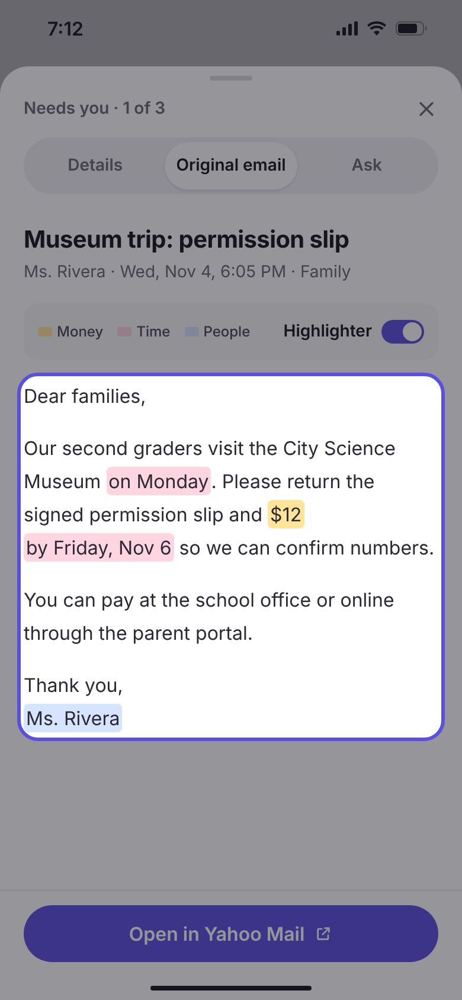

- **Sarah does:** Opens the original email.
- **Sarah thinks:** “Can I pay online?”
- **Glance does:** The whole email with every fact Glance used highlighted. The payment options line is plain text she can read in context.
- **Rule:** Highlighter on by default; one switch turns it off.

```gherkin
Scenario: Sarah reads how to pay
  Given the Lincoln Elementary sheet is open
  When she opens "Original email"
  Then the subject reads "Museum trip: permission slip" from "Ms. Rivera · Wed, Nov 4, 6:05 PM · Family"
  And "on Monday", "$12" and "by Friday, Nov 6" are highlighted
  And "You can pay at the school office or online through the parent portal." is plain text
```

### Sarah 4 · Act: Ticks both steps

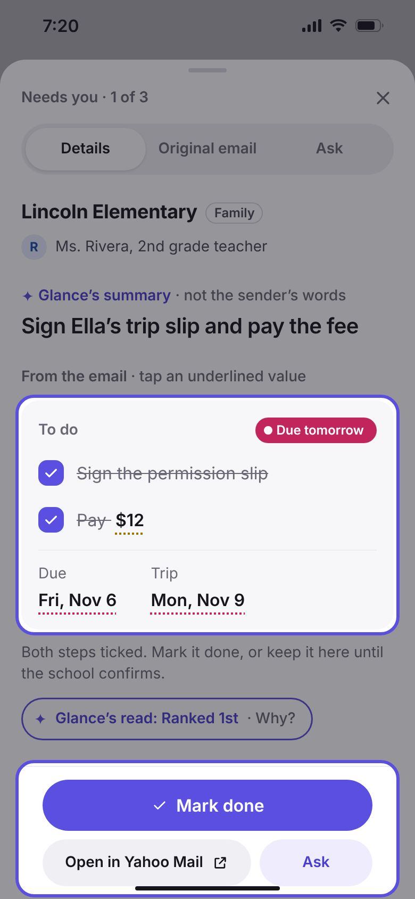

- **Sarah does:** Pays in the parent portal, signs the slip and ticks both steps.
- **Sarah thinks:** “That’s sorted.”
- **Glance does:** With every step ticked, Mark done becomes the primary action.
- **Rule:** One primary per view, and it follows her next step.

```gherkin
Scenario: Ticking both steps makes Mark done the primary
  Given the Lincoln Elementary sheet is open on Details
  When she ticks "Sign the permission slip" and "Pay $12"
  Then both steps are struck through and "$12" stays readable and tappable
  And the note reads "Both steps ticked. Mark it done, or keep it here until the school confirms."
  And "Mark done" is the only primary button, full width
  And "Open in Yahoo Mail" becomes neutral and Snooze is not offered
  But the item is not done until she presses "Mark done"
  When she unticks one step
  Then the bar returns to "Open in Yahoo Mail" as the primary, with Ask, Snooze and Done
```

### Sarah 5 · Close: Two of three done

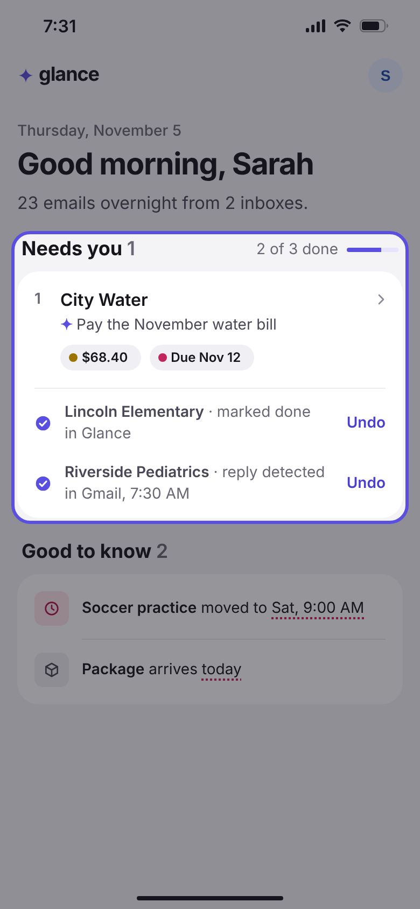

- **Sarah does:** Replies “C” to the clinic from Gmail.
- **Sarah thinks:** “What’s left?”
- **Glance does:** Detects the reply. 2 of 3 done; only the water bill is left, due next week.
- **Rule:** Glance keeps score across both inboxes.

```gherkin
Scenario: Two of three done
  Given she pressed "Mark done" on Lincoln Elementary
  When "Simulate reply to Riverside" is pressed in the demo controls
  Then "Needs you 1" shows only City Water
  And the progress reads "2 of 3 done"
  And the done rows read "Lincoln Elementary · marked done in Glance" and "Riverside Pediatrics · reply detected in Gmail, 7:30 AM", each with Undo
```

### Sarah 6 · Branch · If an inbox drops out: The brief says what’s missing

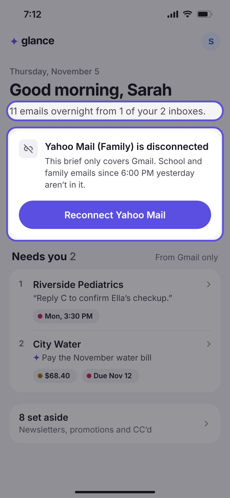

- **Sarah does:** Opens Glance on a morning when Yahoo has disconnected.
- **Sarah thinks:** “Is this everything?”
- **Glance does:** Says what is missing in the coverage line, a notice with Reconnect, and the section header. The school item can’t appear, and Glance says so.
- **Rule:** A partial brief never looks complete.

```gherkin
Scenario: The brief says what’s missing when Yahoo is disconnected
  Given the "Disconnected" pattern built from Sarah’s data with the Yahoo items removed
  Then the coverage line reads "11 emails overnight from 1 of your 2 inboxes."
  And a notice reads "Yahoo Mail (Family) is disconnected" with "Reconnect Yahoo Mail" as the only primary
  And the section header reads "Needs you 2 · From Gmail only"
  And Lincoln Elementary does not appear
```

### Sarah 7 · Branch · After a week away: Still one screen

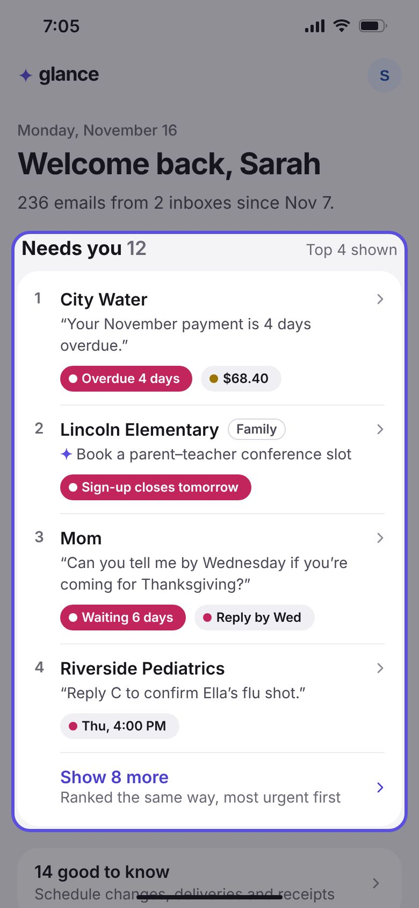

- **Sarah does:** Opens Glance after a family trip.
- **Sarah thinks:** “Where do I even start?”
- **Glance does:** The top 4 of 12, then Show 8 more. The unpaid water bill is now 4 days overdue and first.
- **Rule:** Needs you keeps to one screen.

```gherkin
Scenario: After a week away the brief is still one screen
  Given the "Overload" pattern for Monday, November 16
  Then the heading reads "Welcome back, Sarah" and the coverage line "236 emails from 2 inboxes since Nov 7."
  And "Needs you 12 · Top 4 shown" lists 4 items, City Water first with "Overdue 4 days"
  And the fifth row reads "Show 8 more" with "Ranked the same way, most urgent first"
```

---

## 4. What walking the flows changed

Walking each story on the real screens found three states that had no design, and two small inconsistencies. All are fixed in the canvas, the data and the prototypes.

| Found | Change | Where |
|---|---|---|
| Sarah ticks both steps, but the purple button still says “Open in Yahoo Mail” | When every step is ticked, **Mark done** becomes the one primary, Open becomes neutral, Snooze steps aside, and a note explains the choice (`scene.doneNote`) | D34 · design-rules §8 · design-system §5 · `PhoneDetailChecked` |
| No phone brief after items are done | Done rows with Undo under Needs you, progress “2 of 3 done” | `PhoneDone` |
| Quiet hours were only a line under the coverage text | An evening view: personal only, what is waiting, a way to peek | D35 · design-system §6 · issue 13 · `PhoneQuiet` |
| “Simulate Priya’s reply” read as if Priya had replied | Renamed to “Simulate reply to Priya” (and Sam); the item is done because the user replied | `demo.simulate` in `maya.json`, `daniel.json` |
| Phone said “ranked 1st”, desktop “Ranked 1st”; the phone struck through “$12” with its step | Same label on both; the fact value stays readable and tappable when its step is ticked | Phone frames |

### Not in these flows

- **Maya between meetings on her phone** and **Sarah’s weekend batch on a laptop.** Both use the same screens as the flows above; there is no new state to design.
- **Carried-over items and a time simulator** (the brief the next morning). Out of scope for the demo; see issue 09.
- **First brief** and **new mail on the phone** are designed (`docs/screens/phone-first-brief.png`, `phone-new-mail.png`) and covered by issue 13, but no persona story needs them.

---

## Visual 2.0

Read every step above with these replacements: **Good to know** is the **Heads-up** tab, **Set aside** is the **Other mail** tab, and each tier is a tab instead of a section. The numbers on the tabs are the counts the steps name (Maya opens to Needs you 3, Heads-up 3, Other mail 31, Watchlist 8, Memory 5).

### Steps that changed

**Every persona, step 1 (the brief opens)**

- Given the brief opens on desktop, then the Needs you tab is selected, its first row is selected and shown in the detail panel, and the other four tabs show their counts.
- Given the brief opens on the phone, then the three email tabs fill the width, Watchlist and Memory are header buttons, and no row is open.
- Then the Watchlist tab (or header button) shows a dot when any watched item has news.

**Maya 3 (why is this first?)**

- When she selects “✦ Why it’s first: Renewal risk”, then the panel titled “Glance’s reasoning · not stated in the email” opens with the same judgments and evidence as before.
- Then the panel ends with “Based on Watchlist: Fernway renewal”; selecting it opens the Watchlist tab.
- Then there is no “Move to Set aside” in the panel.

**Maya 7 (new mail)**

- When she selects “Add to brief”, then Okto Freight joins the end of Needs you (count 4), “Revenue Ops Digest” joins the end of Other mail (count 32), and the row reads “2 new added: 1 here, 1 in Other mail”.

**Maya 8 (tidy)**

- Given she opens the Other mail tab, then she sees four rows, each with Glance’s reason, and “27 more like these”.
- When she selects “SaaS Sales Weekly”, then the detail shows the email, the line “Glance put this in Other mail: Newsletter you haven’t opened since September”, and the sentence Glance used highlighted in purple.
- When she selects Move to and then Heads-up, then the row leaves Other mail (count 30), the Heads-up count reads 4, and a toast reads “Moved to Heads-up. Glance will sort emails like this into Heads-up.” with Undo.
- When she opens Heads-up, then “SaaS Sales Weekly: Five renewal plays for Q4” is the last row, marked “Moved by you”.
- When she selects Undo in the toast, then the email is back in Other mail in its old place and both counts are as before.

**Anyone, correcting a false alarm (replaces “Move to Set aside”)**

- Given a Needs you detail is open, when the person selects Move to and then Other mail, then the email leaves Needs you, the next email is selected (on the phone the sheet closes), the counts and progress update, and the toast offers Undo.
- Then the email is the last row in Other mail, marked “Moved by you”, and its detail still shows its facts and sources and says “You moved this here. Glance will sort emails like it the same way.”
- The current tab is checked in the Move to menu and cannot be chosen.

**Done and Snooze** work as written: the email leaves the list and a row with Undo stays under it. There is no toast for them.

**The action bar** no longer has Ask; Ask is the third tab of a Needs you detail.

### New steps

**Heads-up**

- Given Maya opens Heads-up, then the first row is selected and the detail shows “Fernway: 15% discount approved by Lena Ortiz, Finance” as Glance’s summary, the source sentence from Lena Ortiz with “15%” highlighted, “Part of Watchlist: Fernway renewal”, “Open in Outlook” and Move to.
- When she selects Original email, then she sees Lena’s email with the same value highlighted.
- Given Daniel opens Heads-up, then only “Car service” carries the label “Personal”, and its primary button reads “Open in Gmail”.

**Watchlist**

- Given Maya opens Watchlist, then she sees 8 topics; three show “2 new”, “1 new”, “1 new” and the rest “Nothing new”.
- When she selects “2 new” on Fernway renewal, then the Needs you tab opens with Fernway Logistics selected.
- When she selects Add, types “Okto renewal” and selects Add (or presses Enter), then the topic is first in the list with “Nothing yet”, the tab count reads 9, and the toast reads “Added to Watchlist. Emails about it will go to the top.”
- When she selects Remove on a topic, then it leaves the list and the toast offers Undo.
- Add is disabled while the input is empty; Escape or Cancel closes the row.

**Memory**

- Given Maya opens Memory, then she sees “Your instructions 2” and “Learned 3”.
- When she edits a learned pattern and saves, then it moves to the end of Your instructions with “Was learned · edited just now”, the two counts read 3 and 2, and the toast reads “Saved as your instruction. Your instructions always win.”
- When she adds an instruction, then it joins Your instructions with “Added today”.
- When she removes one, then the toast offers Undo and Undo restores it in place.

**Theme and account**

- When the person opens the avatar menu and selects Dark, then the whole app turns dark at once and stays dark after a reload. System follows the device.
- When they select Settings, then the Settings page opens with the same choice shown under Appearance; “Back to brief” returns to the tab they left.
- When they select Log out, then the signed-out page opens; either sign-in button returns to the brief.

**Phone**

- When the person taps a row in any email tab, then the detail opens in the bottom sheet with underline tabs; the sheet closes as before (close button, scrim, Escape, dragging the handle).
- When they tap the Watchlist or Memory button in the header, then that view replaces the brief and “‹ Brief” returns to it.
